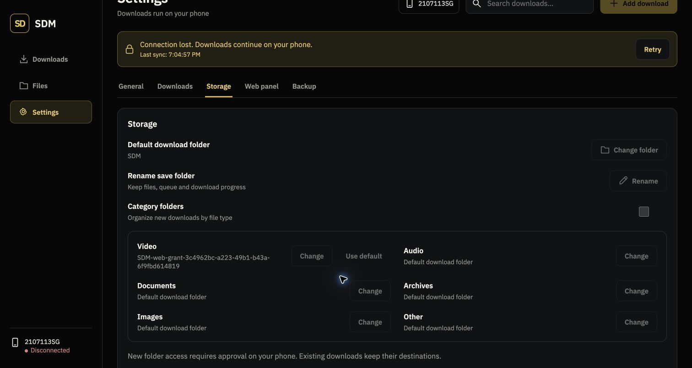
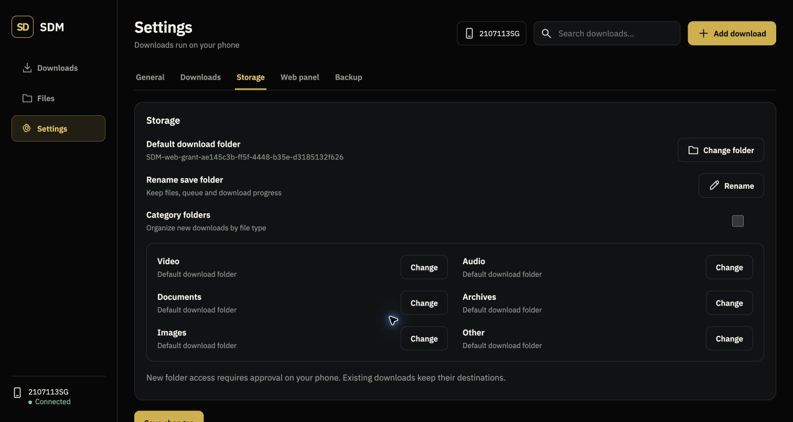
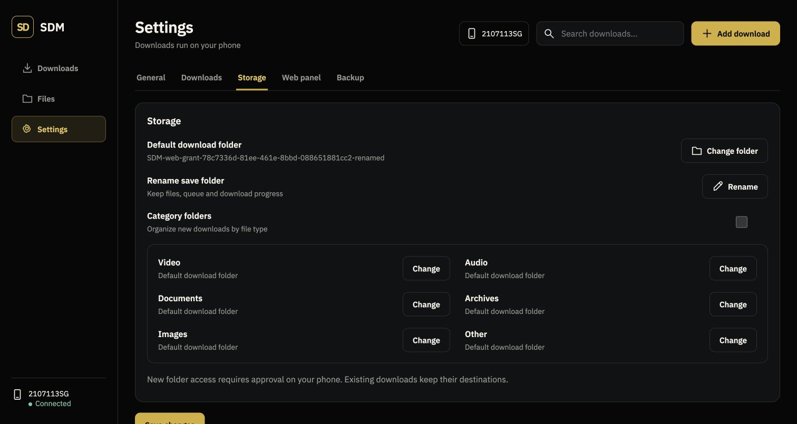
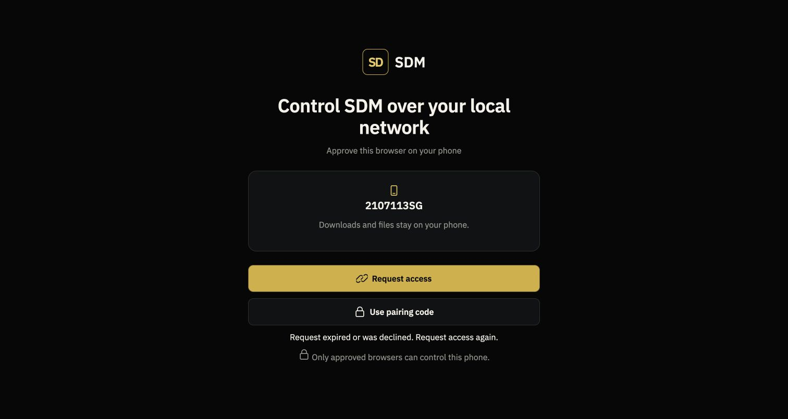
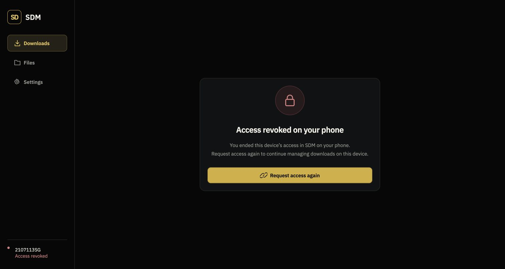
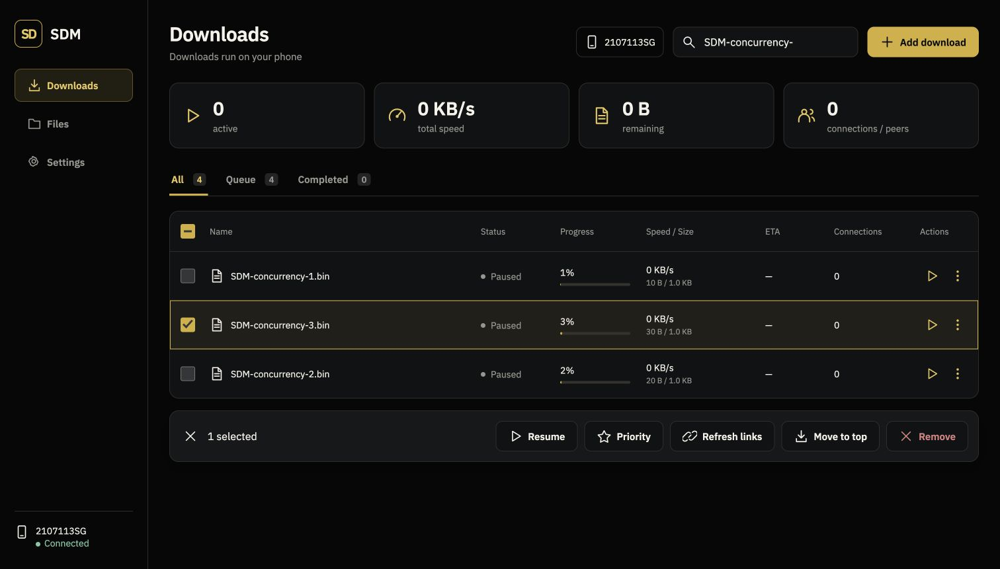
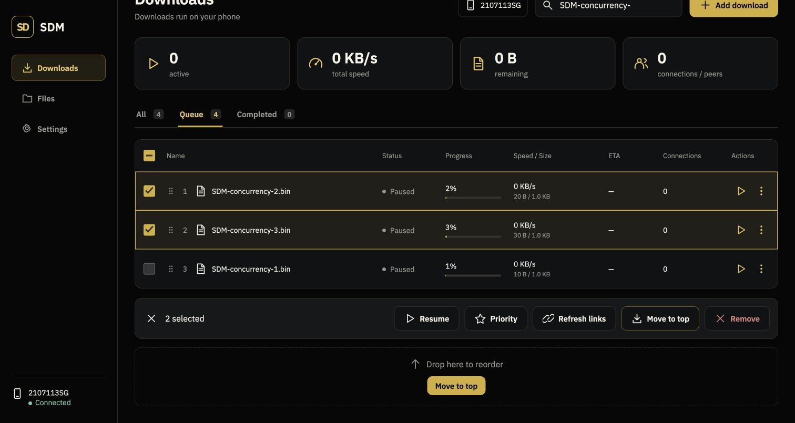

# Web panel device verification — 2026-10-02

Current build is a development build of SDM 0.2.75, installed as an update on Xiaomi phone `30fe7f97`. The emulator was closed at the user's request.

Observed on the connected phone and external Chrome:

- Embedded Ktor serves the panel at the phone's Wi-Fi IPv4 address; VPN interfaces are excluded from LAN address selection.
- Phone approval opens the real shared download list: 18 records, including 9 completed records.
- Refreshing Chrome and force-stopping/reopening the phone app preserve browser approval without another code. The encrypted browser-store hash remained unchanged across restart and APK updates.
- Changing the phone setting from port 8080 to 9090 preserves browser approval through the scoped HttpOnly cookie. Port 8080 was restored after this test.
- Larger text and controls are installed. The SVG sprite is embedded once, so navigation does not refetch icon assets.
- A paused download's details show one Resume button, with no simultaneous Pause button. The latest build also combines the group Pause/Resume controls.

Evidence images: `downloads-desktop-2026-10-02.png`, `single-transfer-control-2026-10-02.png`.

These are interim development checks, not the final feature audit. Full torrent submissions/details, file mutations and folder navigation, permission requests, schedules, link refresh/checksum, backup, responsive visual comparison, transfer fixtures, hostile-client resource limits, and release regressions remain to be completed and verified against the tracked requirements.

## App/web parity audit progress

The expanded settings controls (auto resume, daily resume/pause using the phone time zone, global speed limit, notifications and phone theme) are installed and visible in external Chrome. Backend web unit tests pass, including invalid calendar/time-zone rejection and overnight daily windows. Per-download schedule and speed-limit dialogs are also visible. The cancel action now requires confirmation and explicitly states that the partial file is retained, matching the app. These real-device inspections opened/dismissed dialogs and did not apply changes to the user's downloads or preferences.

Evidence: `settings-desktop-2026-10-02.png`, `schedule-desktop-2026-10-02.png`. These captures are interim render evidence; they do not establish final pixel-perfect acceptance. The expanded app/web acceptance matrix remains open, including all torrent flows, storage mutations, backup and protected-link refresh.

## Torrent metadata / command concurrency progress

The installed phone build serves asynchronous browser-owned metadata drafts. Raw .torrent upload reaches the native parser on the phone, and magnet/URL resolution uses the existing native resolver. Reading metadata does not insert a download. Chrome inspections verified three parsed fixture files, partial selection totals, Select all/none with disabled empty submission, folder group selection and collapse preserving selection, and dismissal leaving all 18 existing downloads intact. Metadata requests have cancellation, expiry and revocation cleanup plus global/per-browser bounds. A draft cannot be committed twice or cancelled mid-commit.

The command cache coalesces identical in-flight commands and no longer serializes unrelated slow operations. The web unit suite passed 26 tests across 8 suites. `WebPanelCommandsDeviceTest` now passed on the connected Xiaomi phone: upload → content selection → queue submission → idempotent replay → per-download limit → schedule → removal of its own unique fixture. The test also verified that the original download IDs remained unchanged. Evidence: `/tmp/sdm-web-device-test.log`, `OK (1 test)`. This is a command integration check; real torrent peer transfer and complete visual acceptance remain open.

See `design-state-matrix.md` for all 21 approved states and their remaining gates. Evidence `torrent-selection-desktop-2026-10-02.png` is an interim capture, not final visual acceptance.

## Custom torrent chooser — 2026-10-02

Replaced the browser-default file input with the approved custom “Choose .torrent file” button. The native file picker remains available through the button and upload-zone click; the input is hidden, and the button disables while metadata resolves. On the connected phone, Chrome selected the three-file fixture through the custom button and displayed the content-selection screen. The metadata draft was cancelled without submitting a download. Evidence: `torrent-custom-chooser-2026-10-02.png`. Drag-and-drop and keyboard regression remain pending.

## Torrent details implementation progress — 2026-10-02

Overview/Files/Peers now use the phone torrent engine's live file-progress, peer address/client/rates, upload counters and tracker verification. Metadata and the seed-after-completion control use TorrentStore; active file selection is read-only. The device command test passed again, now covering metadata/details and toggling seed on/off without changing existing download records. Chrome displayed the fixture's real metadata and all three detail tabs, and paused the fixture successfully. Evidence: `torrent-details-desktop-2026-10-02.png` and `/tmp/sdm-web-torrent-details-device.log`.

Open gates: real peer transfer/trackers/upload, paused/restarted per-file progress persistence, complete desktop/mobile design comparison, completed-torrent file-opening controls. During interactive testing the shared phone scheduler started the newly queued fixture even though Start now was not selected; Queue semantics require follow-up verification/fix. No complete torrent-details claim is made.

## Files commands and fixed download columns — 2026-10-02

`WebFilesDeviceTest` passed on the connected phone (`/tmp/sdm-web-move-device.log`, `OK (1 test)`). It verified rename, same-name collision without overwriting, rejection of path traversal, idempotent rename replay, range streaming after rename and explicit deletion confirmation. The expanded test also created a destination folder, rejected invalid/duplicate folder names, preserved both files on a move collision, verified the moved bytes and completed-record destination, replayed the move without duplication and deleted the moved fixture. Only the test's own files/record were changed; its adjacent collision file remained byte-identical and the original download-ID set was preserved. File selection/list/grid, torrent-folder navigation, storage figures, rename/delete dialogs, HTTP-file move/new-folder controls and supported media previews are implemented. Torrent-folder moves, provider permissions, interruption/storage failures and final visual/operation coverage remain pending.

Downloads now uses a fixed column layout, with the Name column taking the remaining viewport width. Chrome measured widths `[48, 442, 120, 130, 180, 72, 130, 100]` before Pause, while paused and after Resume of the isolated torrent fixture. All/Completed filters also kept identical boundaries. Evidence: `download-column-widths-2026-10-02.json` and `downloads-fixed-columns-2026-10-02.png`. The fixture was removed after testing.

The expanded folder/move phone test also passed after excluding the engine's reserved `.sdm-saf-staging` directory from destinations and rejecting creation with that reserved root name (`/tmp/sdm-web-folder-device.log`, `OK (1 test)`). The Move picker was inspected in Chrome without moving an existing user file. Capture: `files-move-picker-2026-10-02.png`; this is interim evidence, not final pixel acceptance. Inputs without an explicit type now receive the same custom styling as text inputs. Access revocation invalidates pending folder/rename/delete UI state so a delayed response cannot reopen the destination picker.

Native verified per-file torrent progress is now saved atomically every checkpoint interval and on engine shutdown. Web snapshots use it only when its downloaded-byte count matches the repository. A real isolated peer-transfer device test passed (`/tmp/sdm-web-torrent-progress-device.log`, `OK (1 test)`, 30.279 seconds): paused verified progress survived native telemetry release and reading through a fresh `TorrentStore`, then resume, seeding, completion and byte verification succeeded. This proves native persistence, not the still-pending complete web-driven transfer workflow or abrupt process-death coverage. The full JVM suite also passed after these changes (863 tests; `/tmp/sdm-web-torrent-progress-build.log`).

## Completed torrent-folder move verification — 2026-10-02

All four `WebTorrentFolderDeviceTest` methods passed on the connected Xiaomi phone (`/tmp/sdm-web-torrent-folder-full-device.log`, `OK (4 tests)`, 1.116 seconds). Owned fixtures verified whole-tree local moves, selected-file streaming after relocation, collision/descendant rejection, extra files and empty folders, provider write/access failure preservation, and local/provider round trips with updated metadata URIs. Staged committed/uncommitted journals verified recovery, including retaining a changed original until it could be safely reconciled. Original download IDs were preserved. These are staged recovery tests; actual abrupt process termination during copy/publication, storage exhaustion and complete visual comparisons remain open.

## Square file actions — 2026-10-02

External Chrome displayed four icon-only actions on each available completed-file grid card, each measured 48 × 48 CSS pixels with identical row Y coordinates. Every action contains one SVG icon and an accessible label. File icons are on the left and selection checkboxes on the right. Capture: `files-square-actions-2026-10-02.png`. Responsive five-action preview cards and the complete reference comparison remain open.

## Shared controls — 2026-10-02

Installed and inspected custom dropdown chevrons inset 16 CSS pixels with 44-pixel right text padding, settings number steppers, and the shared gold checkbox style. Daily schedule now has a dark/gold Hour/Minute/AM–PM picker; all three selected values align on the same row. Chrome verified minute selection (11:15 AM → 11:16 AM → 11:15 AM) and simultaneous-download increment/decrement without saving changes to phone settings. Evidence: `settings-controls-2026-10-02.png`. Mobile positioning, keyboard interaction and other schedule time fields remain pending. HTTP multiline retries now retain failed links and reuse the same command key after an uncertain response; full integration verification remains pending.

## Time picker keyboard and mobile checks — 2026-10-02

The shared picker also replaces native time fields in the per-download daily-window dialog. Chrome verified ArrowUp changes the highlighted hour, Escape closes without committing the draft, and the unchanged time label remains visible. At 393 × 873 and 320 × 740 CSS pixels, the daily settings picker remained inside the viewport without horizontal overflow (393/320 document scroll widths). Captured `settings-time-mobile-2026-10-02.png`; the temporary viewport override was reset. Per-download daily-dialog interaction and complete reference comparisons remain open.

## HTTP checksum verification — 2026-10-02

Authenticated `/api/download/checksum` uses `DownloadChecksumVerifier`, with its bounded streaming buffer and content-URI support. One checksum job per bridge is admitted at a time; folder mutations are excluded during verification and browser revocation is checked while reading and before responding. The HTTP-details action shows a busy state and reports the native message. Torrent integrity remains the native engine's responsibility.

`WebChecksumDeviceTest` passed on the Xiaomi phone (`/tmp/sdm-web-checksum-device.log`, `OK (1 test)`, 0.335 seconds), covering a multi-buffer fixture match, one-byte mutation mismatch, no reference, paused/missing file, idempotent replay, denied/revoked authorization and preserved original IDs/fixture records. Chrome displayed “No reference checksum available” for an existing completed HTTP download without changing it. Capture: `checksum-details-2026-10-02.png`. JVM tests/build passed; provider, large-file, concurrent native mutations and full design acceptance remain open.

## HTTP link refresh — 2026-10-02

Single HTTP details expose a Check link → review → Replace link and resume flow. Metadata stays on the phone in two-minute browser-owned drafts; the panel receives an opaque token and preservation result. The shared native identity rules require matching strong validators or checksums and compatible range/size before reusing existing bytes. Unsafe replacement requires an explicit restart checkbox. The native repository performs replacement and resets partial files transactionally; the shared scheduler handles resume. Check requests have four global/two per-browser concurrency bounds and drafts have global/per-browser limits. Existing private request context is reused without returning credentials.

`WebLinkRefreshDeviceTest` passed on the Xiaomi phone (`/tmp/sdm-web-link-device.log`, `OK (1 test)`, 0.428 seconds), using actual loopback HTTP metadata and uniquely owned partial files. It proved exact-byte preservation for matching identity, rejection without restart consent, zero reset after consent, cancelled-review rejection and original download-ID preservation. Fixtures were scheduled outside the test window to isolate replacement from transfer. Chrome inspected/dismissed the entry dialog without checking or changing an existing user download. Evidence: `link-refresh-dialog-2026-10-02.png`. Active-transfer pause/check/resume, multi-link assignment, stale-state/expiry and final visual gates remain open.

## Link review concurrency — 2026-10-02

The expanded link device test passed (`/tmp/sdm-web-link-concurrency-device.log`, `OK (1 test)`, 0.724 seconds). A native repository link change after review caused the old review to be rejected with 409 while preserving the new record and exact partial bytes. Replaying a successful confirmed restart with the same command key returned the original response without another reset/submission. The web retains its apply command key across uncertain responses. Active-transfer pause/resume, expiry, browser-owner conflicts and complete bulk/design coverage remain open.

## Backup export and restore — 2026-10-02

Settings now exposes Export backup and Restore backup. The implementation shares native `DownloadBackupCodec` and `LinkArchiveCoordinator`; the native sheet and web both use the AppRepositories factory. Exports are authenticated browser-owned downloads with a ten-minute lifetime, four global/two per-browser bounds and no-store streaming. Restore uploads are capped at the native 5 MB limit, decoded on the phone and held as two-minute browser-owned reviews (four global/two per-browser). The preview shows counts, duplicate skipping and at most 50 names; applying requires explicit confirmation. Existing downloads win, new downloads start paused at zero, and optional settings/category restoration follows native behavior. Partial settings failure reports the number of already restored downloads.

`WebBackupDeviceTest` passed (`/tmp/sdm-web-backup-transport-device.log`, `OK (1 test)`, 1.007 seconds). It verified settings-only export, unauthorized download denial, byte-identical export through actual Ktor HTTP with cookie authorization and correct Content-Length/attachment headers, duplicate detection before mutation, explicit confirmation, one HTTP restoration from three entries with two duplicates skipped, idempotent replay, cancelled review rejection, invalid backup rejection and preserved existing IDs/settings. Chrome selected an owned preview-only JSON fixture and showed its restore summary; it was cancelled without restoration. Captures: `backup-export-dialog-2026-10-02.png`, `backup-restore-preview-2026-10-02.png`.

Actual Chrome export download was reported cancelled by the browser tool even though the panel prepared it. Browser download completion is unverified; the internal chrome://downloads page was blocked by the tool URL policy, so no security-warning bypass or alternate browser-surface inspection was attempted. User clarification is pending. Full torrent/settings/category restore, failure/revocation/expiry and final design comparisons remain open.

## Torrent backup round trip and stale preview — 2026-10-02

Both `WebBackupDeviceTest` methods passed (`/tmp/sdm-web-backup-torrent-device.log`, `OK (2 tests)`, 1.739 seconds). The new test restored a uniquely owned two-file torrent with only file index 0 selected and seeding enabled: the record remained paused at zero, selected total was 3 bytes, native engine telemetry was absent, metadata bytes and the local ownership marker matched. A second export preserved selected indices/seeding/metadata, and reimport skipped the duplicate. Owned files/metadata/records were cleaned up and the original ID set remained intact.

Chrome selected an owned valid preview fixture, then an invalid fixture. The earlier preview and restore action disappeared before parsing the replacement, and the invalid-backup message was visible; no restore was applied. Capture: `backup-invalid-replaces-review-2026-10-02.png`. Empty export selections disable Export; access revocation clears pending backup/link review state. Full settings/category restoration, remaining torrent failure cases, ownership/revocation/expiry, Chrome download completion and final design acceptance remain open.

### HTTP link copy, 2026-10-02

The debug app and instrumentation APK were installed on phone `30fe7f97`. Expanded `WebChecksumDeviceTest` passed (1 test, 0.515 s), including unauthorized link access rejection and exact authenticated URL response. Chrome clicked Copy link on an existing completed download, displayed “Download link copied”, and clipboard validation confirmed HTTPS without logging the URL. Original 18 records remained visible. Capture: `copy-http-link-2026-10-02.png`. Magnet clipboard and final design comparisons remain open.

### Explicit deferred web submissions, 2026-10-02

The web option “Queue (download later)” now requests an explicitly held PAUSED record for HTTP and torrent submissions. Native Queue retains its existing automatic scheduling semantics. Held records are not eligible for unrelated scheduler passes and resume through the existing native scheduler. All 17 `DownloadSubmissionCoordinatorTest` tests passed, including held HTTP bytes/state, scheduler pass and explicit Resume. The installed-phone `WebPanelCommandsDeviceTest` passed (1 test, 1.229 s), checking a held torrent remains paused at zero bytes through a scheduler pass, then its existing limit, schedule, details and safe owned-fixture removal commands. Logs: `/tmp/sdm-web-deferred-unit.log`, `/tmp/sdm-web-deferred-device.log`. Real web HTTP metadata/submission and visual verification remain open.

### HTTP mixed-batch submission on the phone, 2026-10-02

`WebHttpSubmissionDeviceTest` passed on connected phone `30fe7f97` (1 test, 1.059 s). A real loopback HTTP origin served HEAD/range metadata for two unique 128-byte files, with an invalid URL between them. The authenticated add route retained both successes in original order and returned an independent error for the invalid URL. Both created rows were PAUSED at zero bytes with reserved partial files. Replaying the identical idempotency key returned the same response and exactly two rows. Unauthorized submission returned 401 without adding records. The original record-ID set was preserved, and cleanup removed only uniquely owned fixture records/files. Evidence: `/tmp/sdm-web-http-submission-device.log`. Browser form/error rendering, actual resume transfer, destination selection and final design comparison remain open.

### Web API HTTP Resume and completed-file transfer, 2026-10-02

Expanded `WebHttpSubmissionDeviceTest` passed on the phone (1 test, 1.328 s). An authenticated `/api/download/action` Resume completed one unique loopback HTTP fixture through the actual native transfer service. The repository reached COMPLETED with exactly 128 bytes. Authenticated `/api/files/{id}/main/download` returned an exact full-file stream; `Range: bytes=16-31` returned 206, correct Content-Range and 16 matching bytes. The second held fixture remained PAUSED. The native completed-file deletion route successfully cleaned up only the owned test file; original record IDs were preserved. Evidence: `/tmp/sdm-web-http-resume-device.log`. This is device API and stream evidence, not proof of a Chrome download completing or full visual fidelity.

### Submission destination plumbing, 2026-10-02

HTTP submission accepts an optional browser-owned folder token and passes its allocator into the shared native submission coordinator without changing the app default. Folder tokens are revalidated at allocation, local destinations use native collision-safe reservations, and writable granted provider roots use native staging/publication metadata. Provider subfolders are explicitly rejected pending parent-directory support; they never silently fall back to another folder. The build passed; all 18 submission unit tests passed, including collision preservation, selected destination capture and unchanged default allocator. Evidence: `/tmp/sdm-web-destination-build.log`, `/tmp/sdm-web-destination-unit.log`. This work is not a complete destination picker: browser controls, torrent destination handling, provider subfolders, device tests and final design remain open.

### Inline add-destination picker, 2026-10-02

HTTP and torrent content forms now offer an inline picker backed by browser-owned phone folder tokens, with root/up navigation, explicit selection and return to the native default. The chosen allocator is also connected to torrent submission. The debug build and Node syntax check passed; debug APK installed on the phone. Chrome browsed App / Downloads and selected it while retaining the exact typed preview link and Queue choice (no submission performed). Capture: `add-destination-2026-10-02.png`. Actual custom-destination submissions, provider subfolders, unavailable/grant/ownership cases, mobile and final design remain open.

### Custom app-local destinations on the phone, 2026-10-02

Expanded HTTP submission test passed (1 test, 1.885 s): list roots, create a unique local child via web commands, submit two held files to its opaque token, reject a random token before adding records, Resume one file, verify COMPLETED in the selected directory and exact full/range streams. Expanded torrent command test passed (1 test, 0.871 s): create/select a unique local child, upload metadata, submit selected content there held at zero bytes, retain selection/limit/schedule, remove the owned torrent. Both cleanups asserted empty fixture directories before deletion. Original record IDs remained unchanged. Logs: `/tmp/sdm-web-custom-destination-device.log`, `/tmp/sdm-web-torrent-destination-device.log`. Granted provider roots/subfolders, token ownership/expiry and final design remain open.

### Folder token ownership on the phone, 2026-10-02

Expanded `WebHttpSubmissionDeviceTest` passed (1 test, 0.753 s). A separately approved test browser could neither browse the first browser’s folder token nor submit HTTP downloads to it: both requests returned 400 and the original record-ID set was unchanged. The owning browser then completed the existing custom-destination transfer/range checks. Both test browser approvals were revoked during cleanup. Evidence: `/tmp/sdm-web-folder-owner-device.log`. Token expiry/revocation during allocation and provider destination/subfolder gates remain open.

### Persistent provider child destination, 2026-10-02

Added optional per-download `destinationParentDocumentUri`, captured by HTTP/torrent allocators and stored by SQLite migration 12→13. Existing records receive null (the granted root). Native provider directory inspection and HTTP publication now use the chosen parent while retaining the original grant tree; torrent publication uses that parent too. Explicit chosen-directory HTTP failures retain staged bytes and report failure instead of silently publishing elsewhere. Relocation clears old parent metadata; publication retains it only while the grant tree remains the same. All 867 unit tests passed; 27 isolated repository/migration device tests passed (2.054 s), including parent persistence across recreation. `WebProviderDestinationDeviceTest` passed on the phone (0.127 s): a uniquely granted provider root and chosen child, opaque folder allocation, 8,193 exact published bytes inside that child, no file at the root, unchanged app default and owned cleanup. Logs: `/tmp/sdm-web-provider-parent-build.log`, `/tmp/sdm-web-provider-parent-database-device.log`, `/tmp/sdm-web-provider-child-device.log`. Full actual HTTP engine transfer, torrent publication and revocation/recovery for child destinations still need device verification. Earlier notes that provider children are rejected describe superseded implementation.

### Torrent publication to provider child, 2026-10-02

Expanded `WebProviderDestinationDeviceTest` passed (1 test, 0.282 s). Its native publisher fixture allocates a torrent working folder through the chosen provider-child token, creates two-file metadata with only the first file selected, publishes exactly the selected three bytes beneath that child, and confirms a second publication returns the same root and published map. The granted root contains only the chosen child. Fixture working cleanup now calls the native ownership-checked `cleanupWorkingFiles` before removing metadata. This verifies publication of prepared torrent bytes, not a full network torrent transfer through Chrome. Evidence: `/tmp/sdm-web-provider-torrent-device.log`.

### Full web-command HTTP transfer to provider child, 2026-10-02

Parameterized `WebHttpSubmissionDeviceTest` passed both local and granted-provider-child variants on the phone (2 tests, 1.478 s). The provider variant creates a unique granted root, selects a child through folder commands, verifies ownership rejection for a second test browser and invalid-token rejection, releases only the test grant and confirms add returns 400 without new records, restores the test grant, adds a mixed batch held at zero bytes, replays without duplication, resumes one file through the actual transfer service, and verifies its completed URI belongs to the chosen child. Full-file and 206 range streams match the loopback source; the second job remains paused. Cleanup removes only fixture files/records/provider root/grants. Evidence: `/tmp/sdm-web-provider-http-device.log`. Chrome UI transfer, real external provider behavior and final design comparisons remain open.

### Header-phase authentication and body limits, 2026-10-02

The production embedded Ktor service now installs a router header guard before request-body allocation/read. Protected routes authenticate at this point and again at dispatch. Public pairing bodies are limited to 4 KiB, ordinary commands to 256 KiB, backup reviews to 5 MiB and torrent uploads to 8 MiB; targets are bounded to 4,096 characters. Real socket tests send headers declaring large bodies but no body bytes and receive immediate 401/413: unauthorized/revoked upload, oversized pairing, oversized authenticated command and backup review. The command handler is never entered for rejected requests; authenticated state reads still succeed. JVM transport suite and the same phone socket test passed (device 1 test, 0.541 s). APK installed. Evidence: `/tmp/sdm-web-header-guard-build.log`, `/tmp/sdm-web-header-guard-device.log`. Global connection/resource bounds, slow-client and full lifecycle/security audit remain open.

### Settings sections and approved-browser controls, 2026-10-02

Compared current Settings to approved board 05 and added General/Downloads/Storage/Web panel/Backup navigation. Existing controls are grouped without rebuilding inputs on tab changes; changed settings are retained across refresh and only edited keys are submitted, reducing stale overwrites of phone settings. Web panel now lists actual approved browsers, marks the current one, copies the LAN address and offers individual/all revocation with confirmation. Revocation UI routes to existing shared access controls. Unauthorized state clears browser listing and settings draft. Chrome on the installed debug APK verified the actual approved-browser list and a 3→4 draft survived tab switches; restored 3 without saving. Capture: `settings-web-panel-2026-10-02.png`. Storage remains read-only default-location information; global folder/category/rename controls and server port/stop controls are still missing. No design state is accepted as pixel-perfect. Earlier release build/lint passed in `/tmp/sdm-web-release-audit.log`, but final release must be rerun after these UI edits.

## Storage controls — 2026-10-02

The Storage tab now exposes the real default save location and native category destinations. The existing folder picker uses browser-owned opaque references, validates writable root grants again under FolderMutationGate, and preserves every previous grant for existing downloads. Native global/category defaults currently require app Downloads or an individually granted provider root; unsupported child defaults are rejected, while per-download provider-child destinations remain supported.

The shared save-folder rename command is connected with explicit confirmation. Pending Android access is displayed in the panel with instructions to open SDM Settings → Rename save folder on the phone. Storage refreshes after phone changes without rebuilding an unchanged control tree. New Android grant initiation from web and full end-to-end rename/recovery through web are still acceptance gaps. FolderRenameCoordinator now remaps destinationParentDocumentUri alongside the root tree, preserving selected child targets and downloaded-byte progress.

`WebStorageSettingsDeviceTest` passed 3 tests on 30fe7f97 (`/tmp/sdm-web-storage-provider-device.log`). Isolated preferences and an owned DocumentsProvider fixture verified default/category persistence, category enable/clear, foreign/invalid/revoked/unsupported-child rejection without settings changes, retention of pre-existing grants, and parent remapping without altering progress, staging path or record identity. These tests did not change the production default/category settings.

Chrome opened the actual phone panel, reselected the existing SDM root, opened and cancelled the rename dialog, and retained 18 download records. The Storage card is full width with two category columns. Captures: `settings-storage-2026-10-02.png`, `settings-storage-rename-2026-10-02.png`. They are interim implementation evidence, not pixel-perfect acceptance. Latest debug build and installation passed; final release validation must be rerun after all remaining changes.

## Requested save-folder rename redesign — 2026-10-02

The user rejected the oversized, unbalanced rename dialog. The revised dialog uses the approved operation-dialog visual language: compact 460-pixel desktop width, neutral border, title icon, short muted introduction, prefilled full-width 48-pixel input, a small phone-access note and a separated action footer. It focuses/selects the current folder name and disables Rename until a non-empty changed name is entered. The original 18 records remain present; this visual test never submitted a real rename.

Debug packaging passed (`/tmp/sdm-web-rename-design-build.log`) and APK installation succeeded on 30fe7f97. Chrome inspected the actual phone-served panel, not just the temporary localhost design fixture. At 393 × 873 the dialog bounds were x=19, y=244.5, width=355, height=384; the input and body both measured 313 pixels, with no horizontal overflow. Changed-name enabling and empty-name disabling passed. Temporary viewport override was reset. Captures: `rename-dialog-phone-panel-desktop-2026-10-02.png` and `rename-dialog-phone-panel-mobile-2026-10-02.png`. The separate `rename-dialog-redesign-desktop-2026-10-02.png` is a localhost preview and is not phone evidence.

Browser-owned phone-folder request lifecycle/API code has also been added, but its phone UI, notification, browser waiting/cancellation flow and tests are not yet connected; that acceptance gate remains open.

## Phone folder-access handoff — 2026-10-02

This supersedes the preceding note that folder-request UI was not connected. WebFolderAccess now tracks a single browser-owned pending request for two minutes, supports duplicate create/replay, and retains terminal results briefly for polling. Foreign browsers cannot read/cancel another request. Expiry, browser revocation, panel stop and cancellation prevent late picker results from changing destinations. The native confirmation sheet and notification ask the user to open the standard Android folder picker. Result application is serialized with folder mutation, validates writable persisted tree access and uses the real default/category stores while preserving earlier grants. Failed new grants are released; existing grants are retained.

The web picker offers Choose on phone. The waiting dialog restores the same request after a page reload, polls the result, refreshes storage after completion and cancels the phone request from Cancel/Escape. Missing terminal requests after process restart are dismissed as expired rather than waiting indefinitely. The waiting dialog uses a compact 460-pixel layout.

`WebFolderAccessDeviceTest` passed 2 tests on 30fe7f97 (`/tmp/sdm-web-folder-access-device.log`). Isolated preference stores and an owned DocumentsProvider fixture covered default/category result application, already-granted provider results with omitted flags, invalid URI and removed-permission failure, foreign ownership, duplicate creation, cancellation, expiry, revocation, panel stop, late results/replay, prior grant retention and unchanged production default/category settings.

Actual external Chrome sent a default-folder request to the real phone panel. The native phone confirmation sheet appeared (`folder-request-phone-2026-10-02.png`). Reload restored the same waiting flow. Cancel in Chrome closed the dialog and dismissed the native sheet (`folder-request-cancelled-phone-2026-10-02.png`), leaving the existing SDM default and 18 downloads intact. The actual Android system-picker selection and acceptance through the complete UI is still an open gate; fixture result tests do not prove that interaction. Whole-panel fidelity and final release acceptance remain open.

## Web port controls — 2026-10-03

The web LAN settings expose current address, copy, port change and confirmed stop controls. Port requests validate range/integer input, expected current port and availability before mutation. The transport invokes an atomic action only after Ktor ResponseSent; repeated cached responses cannot repeat the mutation. The native server now opens the replacement listener before closing the current listener and restores the old port/address if binding the replacement fails.

Debug packaging and phone installation passed. Actual external Chrome changed the real phone server from 8080 to 8081, navigated to the new address and remained authenticated without another pairing code. It then restored 8080 through the same web control. The original 18-download count remained present. Capture: `panel-port-controls-2026-10-03.png`. Actual occupied-port rollback, stale/concurrent control requests, stopping/restarting with transfer preservation and full design comparison still require tests; this is not full LAN acceptance.

### Occupied-port rollback verified — 2026-10-03

The first device test exposed an asynchronous CIO bind failure that crashed the app rather than reaching the service rollback. The transport now owns a supervisor scope and captures coroutine startup failures while resolvedConnectors reports the failed bind to the caller. The occupied-port JVM test and rebuilt APK passed. `WebPanelPortConflictDeviceTest` then passed on 30fe7f97 (`/tmp/sdm-web-port-conflict-fixed-device.log`, `OK (1 test)`, 0.388 seconds): the previous listener and configured port remained usable, approved-browser IDs and all original download IDs remained unchanged. Chrome reconnected at port 8080 and visibly showed All 18, including unchanged paused progress. The port input now uses the shared custom stepper; the preceding screenshot predates that control change. Network changes, stop/restart, and whole-panel release/design acceptance remain open.

Regression checkpoint 2026-10-03: `testDebugUnitTest`, `lintRelease`, and `assembleRelease` completed successfully (`/tmp/sdm-web-final-regression-2026-10-03.log`). Local graph refreshed. This is packaging/regression evidence; release APK installation and complete acceptance are still pending. Updated actual phone-served Chrome capture: `panel-port-stepper-2026-10-03.png`.

## General settings parity — 2026-10-03

Added the missing reset and SDM version controls. The native and web reset share SettingsReset, serializing category-rule and preference resets under FolderMutationGate; no download records, files or save-location grants are removed. The authenticated endpoint requires explicit confirmation and uses the existing command idempotency guard. Native scheduling/network reconciliation follows web reset. Version is read from the installed package, independently of API protocol version.

WebSettingsResetDeviceTest passed on 30fe7f97 (`/tmp/sdm-web-reset-confirmation-device.log`, OK (1 test), 0.128 seconds), checking isolated defaults/category reset and replay, rejection without confirmation or authorization, unchanged production settings/category rules and exact download records. Debug installation and unit regression succeeded. Chrome inspected About version 0.2.75 and opened/cancelled the reset confirmation without resetting production preferences. The dialog measured 460 × 243 with no horizontal overflow. Captures: `settings-reset-desktop-2026-10-03.png`, `settings-general-parity-2026-10-03.png` (before final reset-card spacing refinement). These are interim implementation evidence; whole-panel pixel acceptance remains open.

The final reset-card spacing refinement built successfully, but installation failed when device 30fe7f97 became offline. The preceding APK with reset/about is installed and inspected; the spacing refinement still needs installation and a fresh capture. No emulator or other connected device was used.

After reset/about and spacing changes, unit regression, lintRelease and assembleRelease passed again (`/tmp/sdm-web-settings-release-regression.log`). Graph refresh and git diff whitespace checks also passed. Release device acceptance remains pending.

## Disconnection and unsent forms — 2026-10-03

Failed polling now updates the status/banner and command availability in place instead of rebuilding the page on every failure. The open modal, focus and typed values survive. A central API guard rejects protected mutations while offline, including commands from dialogs; local close/retry controls remain usable. Reconnection restores only controls disabled by the offline transition and refreshes phone state without retrying blocked commands. Numeric setting drafts are captured on input as well as change; the initial real-browser reconnection exposed the missing input capture and the corrected flow was retested.

Two Node regression tests execute production panel.js with a controlled DOM/transport and exercise repeated polling failure, actual input-event draft capture, rejected POST without dispatch, open-form render suppression and reconnect without command replay. Command: node --test tools/web-tests/panel-disconnection.test.cjs.

WebPanelDisconnectDeviceTest passed on 30fe7f97 (`/tmp/sdm-web-disconnect-input-device.log`, OK (1 test), 21.175 seconds). It stopped the real panel for 20 seconds and restored its original port, while asserting all original download records and approved-browser IDs remained identical. Existing transfers were paused; this does not prove an active transfer continues during panel stop. Runtime stop intentionally cancels pending folder requests.

In external Chrome, an unsent example.invalid link and draft retry count 7 survived the actual outage. Add downloads and Save changes were disabled while disconnected. After restarting the listener the link remained, Add downloads re-enabled, and retry count 7 remained after closing the dialog. Reload showed the unchanged persisted retry count 2 and All 18, proving the unsent changes were never applied. Captures: disconnection-form-preserved-2026-10-03.png and reconnection-settings-preserved-2026-10-03.png. Desktop operation evidence is complete for this narrow flow; pixel-perfect state comparison/mobile/active-transfer evidence remains open.

## External Chrome HTTP transfer — 2026-10-03

A UUID-owned text fixture was served from the laptop LAN origin (192.168.1.7:8765). External Chrome added it through the real phone panel with Queue selected. The row remained paused at zero bytes; explicit Resume completed it on the phone at 100%, 278,528 bytes. The real Files page listed text/plain with the completed size. Capture: http-browser-completed-2026-10-03.png.

WebBrowserHttpFixtureDeviceTest independently read the actual saved destination (including SAF support), asserted COMPLETED and exact length, and matched SHA-256 e3b83d1b5b7b9d7be8acbfd1b69b613c41a25161f1b5e6e6c1ada06a379f43ff. It deleted only this exact UUID/name/URL fixture through the shared file command, removed its record, and asserted the other 18 records remained identical. Passed on 30fe7f97 (`/tmp/sdm-web-browser-fixture-device.log`, OK (1 test), 0.281 seconds). The temporary origin was stopped after cleanup.

Download to computer was attempted from the real Files link. Chrome reported download 3509 canceled immediately; no completed computer file is proven. The user was asked for the visible Chrome download message. The existing canceled-download acceptance gate remains open; this result must not be described as a completed browser file transfer. Whole-panel design comparison, larger/active transfer controls, provider browser flow and full torrent browser transfer remain open.

## Native file open/share handoff — 2026-10-03

Added missing Open on phone and Share on phone actions to the Files action menu and single-file selection controls. Requests carry record ID/index only; WebFiles resolves the authoritative completed HTTP/torrent identity and validates readability. A single browser-owned request expires in two minutes. Duplicate requests do not create multiple prompts; decline, expiry, revocation and panel stop prevent late consumption. The native sheet uses existing SettingsSheet/ArchiveButton controls and displays the file and requesting browser. Phone confirmation re-resolves the current identity, checks panel/browser/expiry again, and uses the same CompletedFileShareAccess as native Files. The phone user chooses the destination app/recipient; the browser never sends directly to a recipient.

WebFileHandoffTest passed two lifecycle/ownership tests. WebFileHandoffDeviceTest passed on 30fe7f97 (`/tmp/sdm-web-file-handoff-device.log`, OK (1 test), 0.188 seconds): unauthorized/invalid/missing-index rejection, stored destination identity, authenticated open/share request, replay, revocation, unchanged fixture record and all original records. The owned fixture was cleaned up. Chrome inspected both new menu buttons on the actual phone-served panel without opening/sharing an existing user file. Capture: file-phone-actions-2026-10-03.png. Compact grid retains the original action row; phone actions are available via file selection. Native system-app launch after confirmation, request notification, mobile and pixel-fidelity acceptance still require evidence. No broad completion checkbox was marked.

Final debug and release packaging, all JVM tests and lintRelease passed (`/tmp/sdm-web-handoff-final-build.log`); JavaScript syntax and disconnection regression tests passed. Graph refreshed and whitespace check passed. Final debug update installed on 30fe7f97. Whole-panel release device acceptance remains open.

### File handoff native prompt and notification — 2026-10-03

The panel foreground notification now observes fileHandoff.pending and shows a file request title, requesting browser and open/share intent, with its existing content action opening SDM. An isolated fixture test held the request while opening the native app. The actual connected phone displayed the confirmation sheet, browser name, UUID-owned filename and Decline/Open controls. Capture: file-handoff-phone-sheet-2026-10-03.png. The inspection run passed (`/tmp/sdm-web-file-sheet-second-device.log`, OK (1 test), 16.376 seconds), then dismissed the request and removed only its fixture. Initial captures taken before SDM was foreground were overwritten and are not evidence.

This supersedes the preceding code gap about notification wiring. Actual notification interaction, decline/open button automation and destination-app launch remain acceptance gates. The capture is native rendering evidence, not proof of a pixel-perfect reference comparison. Original file contents and records were not opened/shared or changed.

## Concurrent phone prompt ordering — 2026-10-03

Browser approval, folder selection and file handoff previously had independent Compose dialogs and could overlap. The phone now renders browser approval first, folder selection second and file confirmation third. Hidden requests remain pending until their turn or expiry. Folder ActivityResult registration remains unconditional, so hiding its sheet does not lose an in-flight Android result callback. The foreground notification follows the same priority.

WebPhonePromptOrderDeviceTest passed on 30fe7f97 (`/tmp/sdm-web-prompt-all-windows-device.log`, OK (1 test), 4.759 seconds). It created only owned requests and inspected all SDM accessibility window roots, verifying file → folder → approval → folder → file with competing prompt titles absent in each stage and original file request identity preserved. It cleaned up only owned requests/approval. The test temporarily enabled interactive-window retrieval in its own UiAutomation service and restored the previous flags. Native destination-app launch, notification interaction and complete design acceptance remain open.

## Atomic web queue group ordering — 2026-10-03

Move to top now performs one SQLite transaction, preserving the native priority tiers and the existing relative order of selected records. Held paused downloads participate in ordering without changing their state or downloaded bytes; completed downloads are excluded. Browser tie ordering uses the same created-at and ID ordering as the native queue. WebQueueGroupDeviceTest passed on the connected phone (`/tmp/sdm-web-queue-fixture-valid-device.log`, OK (1 test), 0.141 seconds), using an isolated database and checking unchanged production records. JVM regression, lintRelease and release assembly passed (`/tmp/sdm-web-queue-atomic-regression.log`).

A follow-up restores native scheduler reconciliation after a changed group ordering and removes the unreachable per-record top branch. JVM tests and debug assembly passed (`/tmp/sdm-web-queue-scheduler-parity.log`, BUILD SUCCESSFUL); the updated debug APK was installed on 30fe7f97. Actual browser group interaction, concurrent phone edits and complete desktop/mobile design acceptance remain open; this isolated repository test does not close those broader gates.

## Web command torrent transfer with real peer — 2026-10-03

TorrentDeviceTest.webUploadSelectionPauseResumeCompletionAndSeedingUseRealPeer passed on 30fe7f97 (`/tmp/sdm-web-real-torrent-device.log`, OK (1 test), 22.786 seconds). The authenticated production WebRouter/WebAppBridge uploaded torrent metadata, selected first.bin only, submitted a held paused record at zero bytes, resumed through the web action endpoint, paused after verified pieces, checked persisted piece progress, resumed to real seeding, read torrent details and disabled seeding through the web endpoint. Completion matched the original 2 MiB payload byte for byte, including provider-backed publication when selected by current settings. Confirmed web removal deleted only the owned fixture. All pre-existing production records remained exactly equal before/after. The fixture approval, metadata resolver and local seeder were cleaned up.

The test uses actual app repositories, scheduler and transfer service plus a separately bound real seeder. It invokes the authenticated router directly; it does not prove Chrome upload/file selection, magnet submission, real LAN transport or pixel-perfect desktop/mobile acceptance. Those broader gates remain open. The initial run rejected the expected asynchronous upload HTTP 202 in the test helper before creating a download; the helper now expects 202 only for the upload endpoint.

### Magnet command transfer — 2026-10-03

The same real-peer acceptance workflow now runs for magnet resolution as well as uploaded metadata. TorrentDeviceTest.webMagnetSelectionPauseResumeCompletionAndSeedingUseRealPeer passed on 30fe7f97 (`/tmp/sdm-web-magnet-transfer-device.log`, OK (1 test), 26.66 seconds). It first canceled an owned metadata-resolution request without creating a download, then resolved a new magnet, selected only first.bin, submitted held at zero bytes, exercised authenticated pause/resume and seeding controls, matched the completed 2 MiB payload exactly and removed its owned record/files through confirmed web removal. Original production records remained identical. This proves router/app-service behavior with a real peer; Chrome/LAN interaction and desktop/mobile design comparison remain separate open gates.

## Add form visual audit — 2026-10-03

Compared the actual phone-served external Chrome Add downloads dialog with board 03-add-links-torrent. Native Chrome radio rendering differed from the reference; shared radio controls now use explicit dark hollow circles and the gold selected ring, with visible keyboard focus and disabled states. Debug assembly passed and the updated APK was installed on 30fe7f97. In real Chrome, clicking Queue and using ArrowRight selected Start now correctly without submitting any download. Capture: add-radio-desktop-2026-10-03.png.

The complete dialog is not visually accepted: optional submission schedule and individual speed-limit controls shown on board 05 are still absent, and pre-submit review/Paste and full matched mobile composition need completion. Existing post-submission schedule/limit controls do not close the missing submission-flow requirement. No broad design checkbox was marked.

## HTTP submission schedule and speed options — implementation in progress

The HTTP Add downloads form now includes No schedule/Scheduled/Daily window and an optional individual KB/s or MB/s limit. The authenticated add endpoint validates both options before probing any links. The shared DownloadSubmissionCoordinator inserts schedule and limit together in the first persisted record before the scheduler runs; the deduplication key includes the limit. Existing callers retain null defaults. The new submissionOptionsPersistBeforeSchedulerCanStartTransfer JVM regression proves an immediate transfer's starter receives the limit and a future scheduled record retains both options without starting. Full JVM tests passed (`/tmp/sdm-web-submit-options-tests.log`), debug builds and JavaScript syntax checks passed.

Phone-served Chrome displayed all new controls; switching to Daily window revealed the existing styled time controls. Capture: add-options-desktop-2026-10-03.png. A semantic-label lookup exposed a missing explicit label association, which was corrected for the schedule/date controls. Actual Chrome submission/persistence, invalid-option device rejection, partial batch outcomes, mobile layout and reference composition remain open; this work does not close whole-form design acceptance.

### Submission-option validation gates — pending phone connection

Added WebHttpSubmissionDeviceTest.submissionOptionsValidateBeforeBatchAndPersistAcrossReplay. Its real HTTP fixture checks zero/invalid limits and malformed daily times reject before inserting records, mixed-batch successful rows persist the chosen schedule/limit, idempotent replay returns the same IDs, closed scheduled windows reject resume, explicit schedule clearing permits the controlled transfer, and fixture cleanup restores exact original production records. The device test APK compiled successfully (`/tmp/sdm-web-options-final-debug.log`). It has not run: ADB currently lists only Quest 3 (2G0YC5ZHBJ02WW), not the authorized phone 30fe7f97. No APK was installed on the other device.

The browser now disables the newly added schedule/limit inputs and time-picker buttons during submission, so the visible draft cannot change mid-request. JavaScript syntax and both disconnection tests passed. LintRelease/release assembly passed before the final asset locking edit (`/tmp/sdm-web-options-device-build.log`); updated debug/test assembly also passed. Phone/API and responsive visual acceptance remain pending.

### Client submission-option validation — 2026-10-03

The production submit-links action now validates schedule/limit options before setting the submitting flag, disabling inputs or dispatching a request. It rejects missing one-time starts, reversed/equal one-time ends, malformed/out-of-range daily times, equal daily boundaries, nonpositive/sub-byte/nonfinite/overflowing speed limits and unknown units. Overnight daily windows remain valid. Validation uses the phone zone in the transmitted schedule.

`node --test tools/web-tests/*.test.cjs` passed four tests, including new production-script VM tests invoking act('submit-links') with invalid inputs: zero requests, retained link text, input still enabled and no submission flag. The valid overnight/decimal-speed case retained exact times, unit and phone zone. Debug assembly passed (`/tmp/sdm-web-options-client-validation-build.log`). The latest APK is not installed because 30fe7f97 remains absent from ADB; real-browser/device persistence and full visual acceptance remain open.

## Mobile submission time-picker clipping — 2026-10-03

Inspected the installed phone-served Add downloads form in external Chrome at 393×873. Daily start/stop controls retained a 155px minimum width, while their two-column layout only had 146.5px per column. The second control overflowed. Opening the first time picker positioned its 250px surface at viewport x=12, outside the clipping dialog body's x=44 boundary; the left hour column and part of Done were clipped. Capture: add-time-picker-mobile-clipping-2026-10-03.png. This is failure evidence, not an accepted design capture.

The source now lets submission time buttons shrink within their grid columns, and positions time-picker surfaces against the actual dialog-body bounds rather than the whole viewport; it also constrains width when needed. Debug assembly and four production-JavaScript tests passed (`/tmp/sdm-web-time-picker-bounds-build.log`). ADB still lists only Quest 3, so the patched APK has not been installed on 30fe7f97 and actual fixed-layout capture remains pending. The temporary Chrome viewport was restored and no download or setting was submitted.

## Read-only HTTP link review — implementation pending phone verification

Added authenticated POST /api/downloads/review using the application's existing DownloadMetadataRetriever. It probes at most four links concurrently, preserves original line ordering and returns each name/known size or sanitized failure independently. It never invokes destination allocation, submission, record insertion or transfer scheduling. The Add links form now exposes Check links and the Detected downloads list. Results from an edited/closed form are discarded, and editing links clears the old result list. Submission continues to perform its own authoritative metadata validation.

WebHttpReviewTest passed with mixed success/exception and out-of-order completions, asserting input order, per-link failures, maximum concurrency four and all probe jobs finished. All JVM tests and debug assembly passed (`/tmp/sdm-web-http-review-verified-build.log`); four JavaScript regressions passed. This new feature is not yet installed or rendered on the authorized phone, which remains absent from ADB. Actual phone transport, Chrome error/ready states, mobile and approved-design acceptance remain open. Check links is currently an explicit review action; automatic/pasted-link review interaction fidelity still requires reconciliation with board 05.

### Automatic link-review interaction — 2026-10-03

Replaced the temporary Check links button with the approved detected-download interaction: typing/pasting links schedules a read-only review after 700 ms of inactivity. An in-flight review does not start overlapping work; a changed draft queues a fresh review. Empty or over-limit drafts do not dispatch. Responses are ignored when the originating input is detached, changed, or its dialog is closed. This supersedes the preceding explicit-review-button limitation.

Six JavaScript regressions passed, including production-script reviewLinks tests proving late results cannot overwrite edited links/closed dialogs and successful name/size rendering preserves the input without entering submission. Updated debug assembly passed (`/tmp/sdm-web-auto-review-build.log`). The patched UI still requires actual authorized-phone installation and Chrome desktop/mobile acceptance. Paste-button behavior, response latency with larger batches, transport/revocation and pre-submit device evidence remain open.

## Runtime transport failure reporting — 2026-10-03

The previous CIO CoroutineExceptionHandler discarded errors after startup. LanHttpServer now exposes an internal failure StateFlow; cancellation remains a normal close. WebPanelService observes only its current transport, closes a failed listener, clears running/address state, cancels ephemeral pairing/folder/file requests, and displays a fixed restart message through native status/notification. Existing approved-browser credentials, settings, folders and the independent download service are retained. Observers are replaced with the listener and canceled with the service.

LanHttpServerTest passed eight cases (zero failures/errors), including occupied-port failure becoming observable and normal close retaining a null failure. All JVM regressions, debug assembly and lintRelease passed (`/tmp/sdm-web-runtime-failure-verified.log`, BUILD SUCCESSFUL in 25 seconds). This fixes the previously recorded swallowed-runtime-error gap. A real post-start engine fault and the native notification/status rendering have not been exercised on 30fe7f97, which remains unavailable over ADB; connected-device lifecycle acceptance remains open.

## Add links Paste control — 2026-10-03

Added the board-05 Paste action beside the link label using a shared SVG clipboard icon. On supported browsers a user click reads clipboard text and inserts it at the captured selection, retaining surrounding links, then schedules read-only metadata review. Unsupported/denied clipboard access focuses the input and explains Ctrl+V/⌘V without changing its draft. Empty clipboard and late results after draft edits, dialog closure or submission cannot overwrite input. Clipboard content is not read automatically. Paste is disabled during submission.

Nine production-JavaScript regressions passed, including selected-range insertion, denied/unsupported access preserving drafts and late-result rejection. Debug assembly passed (`/tmp/sdm-web-paste-links-build.log`). The first selected-range test expected the wrong newline position; its expected surrounding text was corrected. No real user clipboard was read in testing. Actual browser clipboard capability/permission behavior, phone installation and matched desktop/mobile rendering remain pending. In particular, HTTP LAN browsers may require manual paste; this fallback does not imply one-click clipboard access was verified there.

### Real HTTP metadata review evidence — 2026-10-03

WebHttpReviewTest.realHttpMetadataReviewUsesHeadAndOneByteFallbackWithoutPayloadDownload passed using real loopback HTTP sockets and the production HttpDownloadMetadataRetriever (`/tmp/sdm-web-review-real-http.log`, BUILD SUCCESSFUL). Mixed results retained order: ready.bin returned 1 MiB from HEAD; invalid-url made no origin request; fallback.bin returned 2 MiB metadata after HEAD 405 and GET Range bytes=0-0; missing.bin reported HTTP 404 separately. The origin recorded exactly three HEAD requests and one ranged GET. No full-payload GET was requested. This strengthens the read-only review operation evidence but does not prove Chrome/LAN authentication, native preservation or complete design fidelity. Authorized phone 30fe7f97 remains absent from ADB.

## Source parity audit: bulk link refresh gap — 2026-10-03

Compared the native RefreshDownloadLinksSheet source (multi-download candidate matching/selection and guarded per-item apply) with panel.js Downloads bulk toolbar (toggle, priority, top, remove only) and WebLinkRefresh (single-record reviews). Bulk refresh is missing from the web implementation. Added explicit DMF-053.6.4 covering multiline metadata candidates, automatic filename matching plus manual target selection, duplicate-target prevention, individual identity/restart decisions, guarded partial apply and lifecycle tests. The native Browser/session controls remain excluded by user instruction.

The capability matrix also now reflects the already-passed real-peer upload/magnet commands and atomic group queue tests, while keeping Chrome/LAN and visual acceptance separate. This audit is evidence of remaining work; it does not mark parity complete. Phone 30fe7f97 is still absent from ADB; Quest 3 is not a permitted replacement.

### Bulk link refresh partial-result safeguards — 2026-10-03

Added authenticated browser-owned bulk link review/apply/cancel and multiline UI with filename suggestions, manual matching, duplicate-target rejection and individual restart confirmation. Successful replacements are removed from remaining target choices; the server rejects reuse of applied targets and non-integral candidate indices. Check failures clear the pending indicator. Restored backup/single-link dialogs no longer read HTTP submission fields.

Validation: all 13 production JavaScript regression tests passed (`/tmp/sdm-web-bulk-final-js.log`); `:app:testDebugUnitTest :app:assembleDebug` passed (`/tmp/sdm-web-bulk-final-build.log`). This does not accept DMF-053.6.4: isolated device tests for partial failures, active pause, ownership/expiry/revocation and desktop/mobile visual comparisons remain required. ADB currently lists only the Quest device, not the SDM phone; no APK was installed on that device.

Bulk refresh request-state follow-up: draft text, matching selectors, restart checkboxes and request buttons are disabled while Check/Apply is pending and restored afterwards; rendering retains keyboard focus on restart checkboxes as well as matching selectors. The request-state regression increases the production-JS suite to 14 passing tests (`/tmp/sdm-web-bulk-busy-js.log`). Debug packaging and Release lint passed (`/tmp/sdm-web-bulk-busy-build.log`). These are source/build checks; connected-phone visual and operation acceptance remain pending.

Bulk device acceptance preparation: extended `WebLinkRefreshDeviceTest` to exercise the production authenticated bulk routes with owned paused fixtures: fractional candidate index rejection, duplicate-target rejection, retained partial bytes, successful request replay, already-applied target rejection, phone-side stale identity alongside an independently successful mapping, and cancellation rejection. `:app:assembleDebugAndroidTest` passed (`/tmp/sdm-web-bulk-device-build.log`). The new cases have NOT run: ADB recheck still reports only Quest_3, so no device operation evidence is claimed and the checklist stays open.

Bulk stale-draft and revocation follow-up: editing the multiline input invalidates the previously checked token, mappings and Apply control, and releases the owned server review. In-flight controls remain immutable. Bulk checks now revalidate browser approval before touching each active download and before each metadata lookup, with 30-second per-link and 90-second total metadata timeouts. All 16 production-JS tests passed (`/tmp/sdm-web-bulk-stale-js.log`); unit tests and Android test packaging passed (`/tmp/sdm-web-bulk-revocation-build.log`). New phone acceptance cases remain unexecuted; no broad task is checked complete.

### Files app-parity gaps — 2026-10-03

Source audit found missing native file-type filters and Oldest first sorting. Web listing now publishes categories through the actual native `classifyCompletedFile` function and uses the native updated-time fallback when completion time is absent. Files toolbar exposes All/Video/Audio/Documents/APK/Archives and Oldest first alongside approved sorting options, with wrapping for narrow widths. Sorting has deterministic identity ties and retains selection; filtering intersects the existing filename search without mutating phone data.

Validation: all 18 production-JS tests passed (`/tmp/sdm-web-files-filter-js.log`), including category/search intersection, ascending/descending timestamps, ties and selection preservation. Unit tests and Debug packaging passed (`/tmp/sdm-web-files-filter-build.log`); final static-asset packaging passed (`/tmp/sdm-web-files-filter-final-build.log`). These added app-parity controls still need actual phone/browser responsive and visual acceptance. Capability matrix corrected to distinguish these implementations and bulk link refresh from remaining verification gates.

Single-link draft follow-up: URL edits now invalidate and release the old reviewed token and remove its Apply control. Check/Apply requests disable the URL, restart confirmation and both request buttons until completion. Production-JS tests prove the old token cannot dispatch after editing and pending controls unlock correctly. All 20 tests passed (`/tmp/sdm-web-single-link-js.log`); Debug packaging passed (`/tmp/sdm-web-single-link-build.log`). Device USB and mDNS checks found no SDM phone, so latest installed-browser design acceptance remains pending.

### Shared backup preference restoration — 2026-10-03

Native and web backup restoration now use `BackupSettingsRestore` for settings and category rules. Existing granted-access probes remain read-only; unavailable rules are retained and marked unavailable rather than dropped or granted implicitly. Existing runtime scheduling/network reconciliation in the web path is preserved.

Added `WebBackupSettingsDeviceTest` with isolated preferences, codec round trip, granted/unavailable category rules, re-grant availability, legacy settings-only backup preservation and download-only no-op assertions, plus untouched production preferences and download records. Unit regression, Debug APK and Android test APK packaging passed (`/tmp/sdm-web-backup-settings-build.log`). The isolated device test is compiled but unexecuted until the phone returns to ADB; settings/category backup acceptance remains open.

### Completed torrent seeding action — 2026-10-03

Approved board/source comparison found that completed torrent details hid transfer controls even while the torrent was seeding. Details now show Stop seeding bound to the existing shared `detail-pause` command; completed nonseeding torrents still show no transfer action. Two production rendering tests cover both states; all 22 JavaScript tests passed (`/tmp/sdm-web-torrent-stop-js.log`). Debug packaging passed (`/tmp/sdm-web-torrent-stop-build.log`). Actual button operation and screenshot comparison on the latest installed phone version remain pending.

Release lint and packaging passed for the preceding shared-backup/files/link-draft changes (`/tmp/sdm-web-latest-release-check.log`, 23 seconds); that Release APK predates this final Stop seeding asset edit. No release device acceptance is claimed.

### Latest release package / connected-device gate — 2026-10-03

Release packaging including the Stop seeding asset passed (`/tmp/sdm-web-final-assets-release.log`, 7 seconds). A ZIP/SHA-256 comparison verified all six current `assets/web` files exactly match the source assets in the generated Release APK. This proves packaging, not release operation or pixel-perfect acceptance.

Repeated USB and mDNS checks still expose only Quest_3, not SDM phone 30fe7f97. The latest APK and compiled device tests cannot be installed/run on the required phone. Remaining acceptance includes latest HTTP submission options, bulk refresh and backup-settings cases, full Chrome file/backup downloads, provider/system-picker and lifecycle failures, real-browser torrent workflow, all 21 desktop/mobile design states and actual Release operation. The feature remains incomplete; resume device acceptance when the phone is available. No parent checklist is checked off.

### Connected phone acceptance resumed — 2026-10-04

ADB confirmed SDM phone `30fe7f97`; current Debug app/test APKs installed successfully without clearing app data. Initial five-case run found one incorrect test expectation (cancelled bulk review is 409, not 400) and a fixture pairing throttle collision. Corrected only the expected conflict response and separated loopback pairing identities by HTTP fixture type; production rate limits were retained.

The repeated five-case run passed in 2.129 seconds (`/tmp/sdm-web-resumed-device-verified.log`): single/bulk link refresh, shared backup preference/category restoration and all three HTTP submission cases including schedule/limit persistence. Each fixture preserves production data and removes only its own records/files. A further four-case run passed in 2.201 seconds (`/tmp/sdm-web-resumed-files-backup.log`): HTTP/torrent backup round trip, native file handoff API and file rename/collision/range/delete.

Native Chrome control subsequently worked against the phone LAN address. Captured Downloads, Add links and custom daily time picker (`downloads-chrome-resumed-2026-10-04.png`, `add-links-chrome-resumed-2026-10-04.png`, `add-time-chrome-resumed-2026-10-04.png`). Files Documents filtering showed the correct empty result, then All restored the original listing. These are interim captures, not full visual acceptance.

Chrome backup export succeeded through the user's Free Download Manager browser integration. The apparent Chrome cancellation was extension interception awaiting its Download confirmation. Verified `/Users/espitman/Downloads/sdm-backup-2026-10-04.json`: 7,675 bytes, format `sdm-backup`, 18 downloads and settings, SHA-256 `358892391b2bc0a8c4d40638581ebc3fec4f07cccd6fee71cd272517afc06e3f`.

Chrome Add links → Start now completed the owned `SDM-web-browser-218c7cc3-6bef-43c7-ac30-ed65a1cd1214.txt` fixture on the phone. Files → Download to computer → FDM Download saved 278,528 identical bytes on the laptop; SHA-256 `ae07eaed3ad792266b7298280593fb93da2cee72776e4d6c3cdd7ac383a0cb45`. `WebBrowserHttpFixtureDeviceTest` passed (1 test, 0.273 seconds), independently verified the completed phone bytes and removed only the owned phone file/record with the other 18 records unchanged. Temporary origin server stopped and MainActivity reopened. No broad design or Release acceptance is claimed.

### Bounded concurrent transport / Chrome recovery — 2026-10-04

LanHttpServer now admits at most 16 simultaneous requests before reading or allocating bodies. Excess calls receive 503 and Retry-After: 1 without invoking the handler. A permit covers request parsing, handling and response sending and is released in finally. Nine LanHttpServer JVM tests passed (`/tmp/sdm-web-concurrency-test.log`, 1.182 seconds); the new real-socket test occupies all handler slots, sends an extra 8 MiB declared body without actual body bytes, verifies immediate rejection, then verifies all pending calls complete and capacity recovers. This bounds admitted request-body memory; it does not prove raw pre-header connection limits or full hostile-client acceptance.

Updated Debug/test packaging passed (`/tmp/sdm-web-concurrency-build.log`) and Debug installed on phone. `WebPanelDisconnectDeviceTest` passed in 21.174 seconds (`/tmp/sdm-web-disconnect-resumed-device.log`), stopping/restarting only the listener with every existing record and browser approval unchanged. Actual Chrome showed Disconnected, connection-lost message and disabled transfer commands (`chrome-disconnect-resumed-2026-10-04.png`), then automatically Connected with All 18 / Queue 7 / Completed 11 and no new pairing (`chrome-reconnect-resumed-2026-10-04.png`). No original download was active, so ongoing-transfer, network/IP change and process-death requirements remain open. Local Graphify graph refreshed.

### Downloads-table seeding control and native regression — 2026-10-04

Completed seeding rows previously disabled their pause control even though details exposed Stop seeding. Downloads now enables that same native pause command while seeding and labels it Stop seeding; completed nonseeding and offline rows remain disabled. All 25 production JavaScript tests passed (`/tmp/sdm-web-seeding-row-js.log`), including enabled seeding/disabled nonseeding/offline table cases. Debug packaging/install succeeded; local graph refreshed.

Extended both real-peer device workflows to explicitly stop completed seeding via `/api/download/action` pause, assert COMPLETED with no telemetry, then preserve exact bytes and clean owned fixtures. Updated test APK built/installed. Execution did not reach successful acceptance: the first magnet workflow crashed the app within four seconds in jlibtorrent 2.0.12.9 native code (SIGSEGV, `/tmp/sdm-web-stop-seed-real-peer.log`, Android crash buffer 2026-10-04 23:07:17). The process terminated before either test completed; no new torrent checklist is marked complete. App MainActivity reopened afterward. Native cancellation/session lifetime diagnosis remains required, along with actual Chrome seeding control and full visual acceptance.

### Magnet native handle lifetime diagnosis — 2026-10-04

Inspected the actual packaged jlibtorrent Java bytecode. `SessionManager.getTorrentHandles()` returns wrappers built from `torrent_handle_vector.get()` and drops the vector; SWIG `doGet` constructs each handle with `swigCMemOwn=false`, so these pointers borrow storage owned by the now-unreferenced vector. The resolver previously used those pointers after the getter returned. Replaced that getter with an explicitly retained vector, all handle operations inside try and vector deletion in finally before the next polling delay. This removes a concrete use-after-free risk consistent with the native crash; stripped native symbols prevented identifying the precise faulting C++ function.

Debug packaging succeeded (`/tmp/sdm-magnet-vector-build.log`) and updated APK installed. The same two real-peer tests were started against the corrected resolver (`/tmp/sdm-magnet-vector-device.log`). No completion claim is made until both finish successfully; actual browser flow/design gates remain open.

Follow-up evidence: corrected resolver remained alive through the first magnet case, but it failed waiting for web metadata ready after 60 seconds. The upload case was still active at the last live instrumentation poll (terminal session 11842). Neither workflow is counted as passed. The device test now checks failed-draft status immediately and reports the resolver error rather than silently polling a failed draft until timeout; this diagnostic edit has not yet been packaged. Existing transfer settings must remain unchanged while diagnosing timing/peer/policy effects.

The run subsequently finished: two failures. Magnet metadata timed out; upload reached completed seeding and accepted Pause, then failed the invariant that stopping seeding retains COMPLETED with no telemetry. This is a concrete native state-transition issue requiring investigation, not successful acceptance. MainActivity reopened after instrumentation. No broad checklist was checked.

### Stop seeding completion/publication correction — 2026-10-04

Engine cancellation previously always persisted PAUSED, even after all selected bytes were verified and telemetry was seeding. That made the web Stop seeding command turn a finished transfer back into a paused download. The cancellation path now pauses/flushes the native handle, publishes verified selected files and retains COMPLETED when verified bytes equal the selected total and the engine is actually seeding. Partial transfers retain existing exact-offset pause behavior; publication/flush failure yields a sanitized FAILED state rather than claiming completion.

Debug/test packaging and installation passed (`/tmp/sdm-seeding-completion-build.log`). The first rerun passed the new COMPLETED/no-telemetry invariant, then failed a now-invalid test request to change seeding after COMPLETED (400, explicitly unsupported by the API). Removed that obsolete post-completion setting mutation. Final test APK built/installed and the real-peer upload workflow was rerun (`/tmp/sdm-seeding-final-device.log`); final exact-byte/original-record/cleanup acceptance is pending until the run finishes. The separate native seeding-switch tests remain intact. Magnet metadata failure remains unresolved.

Final rerun passed: `OK (1 test)`, 25.681 seconds (`/tmp/sdm-seeding-final-device.log`). Real-peer uploaded torrent selected-file transfer, exact persisted partial pause/resume, completion/seeding, explicit stop-seeding command retaining COMPLETED/no telemetry, final selected bytes, preservation of every original record and owned-fixture cleanup all succeeded. This verifies the engine/command correction; actual Chrome torrent transfer and matched visual captures, magnet metadata and remaining release/lifecycle gates remain open.

### Magnet metadata premature stop flag — 2026-10-04

The diagnostic rerun with retained native vector but the previous flags failed again at metadata readiness (`/tmp/sdm-magnet-diagnostic-device.log`). The upstream primary reference explicitly says `stop_when_ready` triggers when peers connect, including metadata download, and prescribes `upload_mode` for metadata-only magnets: https://www.libtorrent.org/reference-Core.html and https://www.libtorrent.org/reference-Session.html. Removed STOP_WHEN_READY from resolver submission while retaining UPLOAD_MODE and explicit AUTO_MANAGED removal before resume. This preserves metadata-only behavior without stopping before metadata arrives.

Debug packaging passed (`/tmp/sdm-magnet-metadata-flags-build.log`), installed on the phone and the metadata-only plus full web magnet real-peer tests started (`/tmp/sdm-magnet-metadata-flags-device.log`). Acceptance depends on actual results; browser/design gates remain open. Local graph refreshed.

Final result: `OK (2 tests)`, 25.312 seconds (`/tmp/sdm-magnet-metadata-flags-device.log`). Metadata resolver matched the real peer's selected file metadata and removed its temporary resolver directory. Full web-command magnet workflow verified cancellation without record insertion, selected-file held submission, verified partial pause/persist/resume, completion/seeding, Stop seeding retaining COMPLETED/no telemetry, exact final payload, preservation of original records and owned-fixture removal. The prior premature-stop failure is resolved in this run; actual external Chrome flow and full pixel-perfect/lifecycle/release acceptance remain open.

### Empty-download design action / keyboard focus — 2026-10-04

Compared boards 01 and 07 against source. Empty Downloads lacked the approved Add torrent entry point. Added it beside Add links, connected directly to torrent upload and included it in offline disabling. Added visible gold keyboard focus to the existing name/detail controls so their Enter/Space actions have a visible focus indication. All 25 JavaScript regressions passed (`/tmp/sdm-web-empty-actions-js.log`); updated Debug packaging/install passed (`/tmp/sdm-web-empty-actions-build.log`), graph refreshed.

Actual Chrome capture could not yet be taken: the user closed the SDM tab and was actively changing Chrome tabs/pages; native automation rejected the new-tab action on detecting user changes. No further action was taken against unrelated user pages. No visual acceptance is claimed and no design gate is checked complete. Design-state matrix reconciled with current real-peer/phone persistence evidence while preserving all unverified browser/visual gates.

### Full regression and responsive Chrome correction — 2026-10-04

Bulk link apply no longer swallows CancellationException when resuming an updated record: cancellation propagates and stops subsequent mappings; ordinary resume failures still return the existing warning. Full JVM regression, lintRelease and Release assembly passed (`/tmp/sdm-web-resumed-full-release-check.log`, 56 seconds). This Release package precedes the subsequent mobile CSS correction.

Chrome extension-backed DOM control recovered; created a dedicated SDM tab connected to the phone. Searching an unmatched fixture label rendered both Add links and Add torrent (`empty-actions-chrome-2026-10-04.png`); Add torrent opened the actual upload dialog directly without inserting records. This proves the no-match flow, not a truly empty phone repository.

At 390 × 844, real phone-served Downloads had horizontally overflowing grid columns for long names (342.961/431.609 px name columns inside 358 px cards), hiding actions and extending the progress bar. Changed the mobile grid to a zero-minimum flexible name track, reset cell/text minima and removed obsolete name padding. Updated Debug installed/reopened; Chrome measured every sampled card at 358 px with 24/244/36 px tracks, and document scrollWidth exactly matched viewport 390 px. After fonts loaded, captured `downloads-mobile-card-fixed-2026-10-04.png`; actions are visible and names truncate inside cards. Temporary viewport override reset; dedicated SDM tab retained as a deliverable. Full approved mobile composition and all-state pixel-perfect acceptance remain open. Local graph refreshed.

### External Chrome real-peer magnet acceptance — 2026-10-04

Added `TorrentDeviceTest#externalChromeMagnetFixture` to keep an owned real peer/tracker alive while external Chrome drives the actual phone-served panel. The fixture retains the production-record snapshot, publishes its test magnet, waits for only the matching newly created record, verifies first-file-only selection, exact selected payload and unchanged originals, then removes only its owned record/files using the shared removal command. No user settings changed.

In the dedicated Chrome tab, entered the live test magnet → Resolve metadata → actual selection dialog. Unselected second.bin, selected Queue, then Add selected files. Torrent details showed PAUSED, 0 bytes and Selected files (1 of 2). Resume → Pause showed 65.5 KB/3% persisted progress; Resume completed at 100% / 2.1 MB, no peers, no transfer controls. Captured `browser-magnet-selection-2026-10-04.png`, `browser-magnet-active-2026-10-04.png`, `browser-magnet-paused-2026-10-04.png`, `browser-magnet-completed-desktop-2026-10-04.png` and `browser-magnet-completed-mobile-2026-10-04.png`. The resolving-named capture was taken after the selection dialog arrived and is not resolving-state proof.

Connected-phone verification passed (`/tmp/sdm-browser-magnet-fixture-device.log`, `OK (1 test)`, 195.939 seconds), confirming exact bytes and preservation of all original records plus owned cleanup. Viewport reset and MainActivity reopened after instrumentation. This proves a real external Chrome magnet/selection/Queue/pause/resume/completion workflow; Chrome uploaded-torrent/seeding, full approved composition and all-state visual acceptance remain open. Local graph refreshed.

### Files/mobile settings measured acceptance — 2026-10-04

Phone-served Chrome Files list at 390 × 844 showed the same long-name intrinsic grid overflow as Downloads. Set its name column to minmax(0,1fr), allowed cells/text to shrink, and constrained folder-button text. Debug rebuilt/installed (`/tmp/sdm-web-mobile-files-build.log`) and local graph refreshed. Real Chrome loaded listing now measures document width 390 and first card 358; captured `files-mobile-list-fixed-2026-10-04.png` after data arrived (initial Loading capture was replaced).

Grid view capture `files-mobile-grid-2026-10-04.png` verifies requested icon-left/selection-right composition and all four action rectangles: Download/Rename/Move/Delete each 48 × 48, same y=688, x=39/95/151/207. Document remains 390 px wide. Settings Downloads capture `settings-mobile-resumed-2026-10-04.png` shows contained controls and gold checkbox with document width 390; settings were observed only, never saved. Viewport reset and dedicated tab retained. This validates these measured controls/containment, not complete board fidelity or untested phone-file mutations.

### HTTP details mobile title and read-only controls — 2026-10-04

Installed current Debug APK on connected device 30fe7f97 and checked external Chrome at 390×844. Long HTTP title previously expanded document width to 466px; after wrapping the title and preserving the back-button width, document scroll width equals viewport width (390px). Back button now exposes “Back to downloads”. Capture: `http-details-mobile-title-fixed-2026-10-04.png`.

Speed preset “1 MB/s” enables the numeric field, sets it to 1 and selects MB/s. Daily schedule picker ArrowDown changes 01:00 AM to 02:00 AM; Done returns focus to its opener. Capture: `schedule-mobile-keyboard-2026-10-04.png`. Dialog changes were canceled; no original download settings were saved. Debug assembly and local graph refresh succeeded. These checks do not prove applied scheduling, runtime throttling, or full visual fidelity.

### External Chrome torrent upload and Stop seeding — 2026-10-04

`TorrentDeviceTest#externalChromeUploadFixture` kept an owned real loopback peer/tracker available. Chrome chose the generated .torrent through its file chooser, unselected second.bin, enabled Seed after completion and submitted. Details showed Seeding at 100%, selected first.bin only (2 MiB). Stop seeding changed the row to completed with zero transfer rates. Device verification checked exact published first.bin bytes, original-record equality and removal of only the owned fixture. `/tmp/sdm-browser-upload-device.log`: OK (1 test), 102.34 seconds. Captures: `browser-upload-seeding-2026-10-04.png`, `browser-upload-stopped-seeding-2026-10-04.png`. This proves the actual upload/selection/seeding-control workflow, not all peer telemetry or full visual fidelity.

Latest production assets also passed `:app:lintRelease :app:assembleRelease` in `/tmp/sdm-web-current-release-check.log`, 45 seconds. Release was built, not installed or accepted on device.

### HTTP-details rename parity — 2026-10-04

Added a Rename control for HTTP download details, using authenticated/idempotent `/api/downloads/rename` and the same DownloadRenameCoordinator as native. Existing Files rename remains completed-only. Download rename permits native-supported inactive states and returns the native pause-required failure for active states. No torrent metadata names are editable.

`WebDownloadRenameDeviceTest` passed on the connected phone (0.262 seconds): paused partial bytes and downloaded count preserved, collision and traversal rejected without changing bytes, replay returned the original result, Connecting rename rejected, original records unchanged, only owned fixture cleaned. 25 JavaScript checks pass. Actual Chrome opened the populated Rename dialog and canceled without changing the user's file; capture `http-download-rename-dialog-2026-10-04.png`. Provider rename, actual transfer resume after rename, and complete visual acceptance remain open. Current Debug installed; earlier Release predates this change.

### Real HTTP resume after web rename — 2026-10-04

Extended `WebDownloadRenameDeviceTest` with an owned loopback HTTP origin and matching ETag/range support. After the authenticated web rename and active-state rejection, the production DownloadTransferEngine resumed the renamed partial using `Range: bytes=5-`, completed 100 bytes and produced a byte-for-byte matching final file under the new name. Original records remained identical and all owned server/files/records were cleaned up. `/tmp/sdm-web-rename-resume-device.log`: OK (1 test), 0.481 seconds. This exercises the production engine after a web command, not a Chrome Resume click or provider-backed partial rename.

Current rename implementation regression: `:app:testDebugUnitTest :app:lintRelease :app:assembleRelease` passed, BUILD SUCCESSFUL in 1m 9s; 877 JVM tests, zero failures/errors/skips. Log `/tmp/sdm-web-rename-full-check.log`. Release includes the latest rename endpoint/control, but has not been installed for final Release acceptance.

### HTTP details control hierarchy — 2026-10-04

Moved Rename/checksum/refresh/remove into a separate file-operation row. Desktop keeps transfer/priority/copy in the hero; mobile places its sole visible Resume/Pause and Cancel row after the speed chart, retaining Priority and Copy link in the operation area. Metrics now share a divided surface. Real phone-served Chrome at 390×844 showed equal 174px transfer buttons, document width 390px and keyboard focus advancing from Resume to Cancel without activation. Captures: `http-details-mobile-controls-layout-2026-10-04.png`, `http-details-mobile-transfer-row-2026-10-04.png`. Debug built/installed; 25 JS checks passed before the final desktop-only button-color correction. Local graph refreshed. Header, full mobile composition, compact technical presentation and overall pixel fidelity remain unaccepted. Release predates this layout change.

### Compact mobile HTTP detail header — 2026-10-04

HTTP detail mobile now uses a single Back/Download details header; the desktop search/add/device header and duplicate filename strip remain desktop-only. This matches the reference mobile header hierarchy while preserving all desktop controls and mobile access through Back. Phone-served Chrome capture `http-details-mobile-compact-header-2026-10-04.png` at 390×844 shows chart and transfer buttons in the first viewport. At 320×740, document scroll width equals 320 and exactly one Back control is visible; clicking it returns to All 18 / Queue 7 / Completed 11. Debug built/installed; 25 JavaScript checks pass. Full reference composition and remaining mobile states are still not accepted.

### Active HTTP transfer during listener outage — 2026-10-05

`WebPanelDisconnectDeviceTest#listenerOutageDoesNotInterruptActiveHttpTransfer` runs the production DownloadTransferEngine against an owned throttled loopback origin. Once at least 32 KiB is downloaded, it stops only WebPanelRuntime, waits four seconds, verifies downloaded bytes increased and the record remains DOWNLOADING, restores the original port and verifies exact 1 MiB completion. Original records and browser approvals remain identical; fixture/server/files are cleaned and listener restored. `/tmp/sdm-web-active-outage-device.log`: OK (1 test), 9.984 seconds. Chrome snapshot after listener recovery showed All 19, one active, 107 KB/s and one connection; capture `http-active-listener-recovered-2026-10-05.png`. This uses the production engine directly, not a foreground-service/process-restart test. Browser disconnected-state capture was not taken during this four-second interval. Torrent outage, Wi-Fi/IP changes, service/process recovery and full visual gates remain open.

### Web Resume / real foreground download service outage — 2026-10-05

`WebPanelDisconnectDeviceTest#webResumeServiceSurvivesListenerOutage` submits authenticated `/api/download/action` Resume through WebRouter/WebAppBridge for an owned paused HTTP fixture. The production queue scheduler/download service performs the transfer. During four seconds of stopped listener, bytes increase and state remains DOWNLOADING; after restart the service completes exact 1 MiB bytes. All pre-existing records and approvals remain identical after excluding/revoking the owned temporary browser. Fixture files/record and origin are cleaned and original listener port restored. `/tmp/sdm-web-service-outage-device.log`: OK (1 test), 10.124 seconds. This closes the direct-engine-only limitation for listener shutdown; it is not a process-death or actual Chrome button-click test. Chrome snapshot taken after cleanup showed original All 18 / Queue 7 / Completed 11.

### External Chrome group-to-top queue workflow — 2026-10-05

`WebQueueGroupDeviceTest#externalChromeGroupTopFixture` inserts three owned PAUSED records in a distinct priority tier so no original tier is rebased. In actual Chrome, searching SDM-queue-browser, checking item 3 then 2 and clicking Move to top produces displayed order 2, 3, 1. The fixture independently checks ordered IDs, PAUSED state, persisted downloaded counts (20, 30, 10 bytes), priority and unchanged original records, then deletes owned IDs only. Repeated with a longer capture window because the first post-command screenshot was stale. Final `/tmp/sdm-web-browser-queue-device.log`: OK (1 test), 122.576 seconds, including independent fixture cleanup/preservation verification. Current captures `chrome-queue-group-top-2026-10-05.png` and `chrome-queue-group-top-mobile-2026-10-05.png` show the reordered fixture; mobile document width equals 390px. This is record-order/count verification, not physical partial-file or drag-and-drop verification. Full queue design and concurrent reorder gates remain open.

### Group toolbar placement and action eligibility — 2026-10-05

Historical implementation placed the controls above the table. Reinspection of board 01 on 2026-10-06 shows the approved bar below the list; the old placement was a deviation and is superseded by the correction below. Selected rows expose aria-selected and gold outline/tint. Actual external Chrome measured toolbar y=319 and table y=417. Added a named Selected downloads group. Completed-only selections disable Resume, Refresh links and Move to top; a paused HTTP selection enables all three. Chrome checked both cases without executing any command on user records, then cleared selection. Capture `chrome-selected-toolbar-above-table-2026-10-05.png`. Debug built/installed and 25 JavaScript checks pass; local graph refreshed. Full desktop/mobile design and all mixed-selection/concurrency gates remain open.

### Native-equivalent remaining-time formatting — 2026-10-05

Downloads table, HTTP details and torrent details now share the native `formatDetailsRemaining` convention: upward-rounded seconds as MM:SS or HH:MM:SS, and an em dash when total is unknown, speed is zero or remaining bytes are nonpositive. Production-JS regressions cover 10 seconds, 07:12, 01:02:03, completed/overshot/unknown/stopped values. `/tmp/sdm-web-eta-js.log`: 27 tests pass. Debug installed.

Re-ran the production-service outage fixture and observed the real Chrome row at 94%, 983.0 KB/1.0 MB, 108 KB/s, one connection and 00:01 ETA. Capture `http-active-eta-seconds-2026-10-05.png` includes the disconnected banner because instrumentation termination left Chrome displaying the last snapshot; it proves displayed ETA formatting, not a connected final state. `/tmp/sdm-web-eta-active-device.log`: OK (1 test), 10.109 seconds, exact-byte completion/original preservation/owned cleanup. MainActivity restarted afterward. Full chart/ETA visual and broader state gates remain open.

## HTTP composition and disconnected metrics — 2026-10-05

The installed phone package now orders HTTP metrics as speed, downloaded bytes, remaining time and connections; Schedule and Speed limit use compact paired icon cards. Desktop technical information is split into destination, host/security/resume, headers and segment cards. Mobile uses the approved technical-information disclosure, initially closed. Chrome at 390 × 844 verified click opens it, Enter closes it, and document width remains exactly 390 px. No transfer or file mutation was run on the original paused record.

Captures: `http-details-cards-desktop-2026-10-05.png`, `http-details-disclosure-mobile-2026-10-05.png`. These prove the specific revised structures, not complete pixel-perfect acceptance; mobile hero/metric composition and chart details still differ from the approved board.

The preceding offline-metrics change displays unavailable live speed/ETA while disconnected and restores current phone values without replacing a focused unsaved form. All 29 production-JS tests pass. The real listener-outage test passed in `/tmp/sdm-web-offline-metrics-device.log` (OK, one test, 20.295 seconds); capture `chrome-offline-metrics-unavailable-2026-10-05.png`. This does not prove process-death or Wi-Fi/IP recovery.

## Bulk link replacement device acceptance — 2026-10-05

`WebLinkRefreshDeviceTest` passed on the connected phone: `/tmp/sdm-web-bulk-link-acceptance-device.log`, OK (1 test), 1.039 seconds. The production routes reject fractional and duplicate target mappings before changing the fixture; same-file replacement keeps the 40-byte partial file; idempotent replay returns the same response; a target changed independently on the phone fails while another valid target succeeds; cancelled review cannot apply. Original record IDs remain unchanged and owned records/files are cleaned up. This also reruns single-link identity, restart-confirmation and stale/replay cases. The test uses inactive fixtures and does not prove active-transfer pause/recovery, browser expiry/revocation or actual Chrome mapping interaction.

## HTTP mobile reference composition — 2026-10-05

The phone-served Chrome page now follows board 07's mobile hierarchy: file identity tile/name/destination, progress ring with downloaded bytes/ETA/speed, paired connection/time cards, compact chart, transfer controls, and collapsed technical information. Schedule/limit and the remaining file actions remain reachable inside the technical disclosure. Desktop retains the ring/name/transfer hero, four metrics and split information cards; source host is redacted by the native snapshot helper.

Chrome captures: `http-details-mobile-composition-2026-10-05.png` and `http-details-desktop-composition-2026-10-05.png`. At 390 × 844, the hero is 358 px wide and the speed chart is 100 px tall; document width is 390 px. At 320 × 740, document width is exactly 320 px. Opening the disclosure reveals both Edit controls and all six auxiliary actions; desktop Rename remains visible after resetting the viewport. Existing 29 JS regressions pass (`/tmp/sdm-web-mobile-details-js.log`); debug packaging/install succeeded. Original downloads were only viewed, with no transfer or file mutation.

These are intermediate visual evidence, not full pixel-perfect acceptance: axis spacing, typography, reference fixtures and remaining screens still need matched comparisons. Speed-history sample timing across outages also remains a functional audit item; a rendered axis is not proof of a sixty-second time window.

## Timestamped history and current release checks — 2026-10-05

HTTP and torrent history now retain local receipt timestamps, position samples within the actual previous 60 seconds and discard expired/future/invalid samples. A gap over 2.5 seconds starts a new path instead of interpolating through a listener outage. A single fresh sample is visible as a point. Both upload and download histories are cleared when their record disappears. Four focused timing/gap tests pass; total production-JS regression count is 33 (`/tmp/sdm-web-history-js.log`).

Current debug and release packaging, `testDebugUnitTest` and `lintRelease` passed: `/tmp/sdm-web-history-build.log`, `/tmp/sdm-web-current-release-check.log` (BUILD SUCCESSFUL in 47 seconds). JVM XML results: 877 tests, 0 failures, 0 errors, 0 skipped. Graph refreshed locally.

Installation of this latest history patch did not happen: adb reports no connected devices and install returns device not found. The connected-device visual/history-outage test and release install remain open. Earlier screenshots show the preceding installed composition, not this new history implementation.

## Single-link expiry during mutation-lock wait — 2026-10-05

Source audit found that the single-link apply path checked review expiry before waiting for FolderMutationGate but did not recheck it after acquiring that lock. It now verifies browser approval and expiry immediately before the repository mutation, matching the bulk path. It also rechecks browser approval before pausing an active transfer and before retrieving replacement metadata.

The device fixture now includes a deterministic clock-driven expiry case: acquire the mutation lock, begin apply until it suspends behind the lock, advance past the review lifetime, release the lock, then require rejection and unchanged record/partial bytes. This new case compiled in `assembleDebugAndroidTest` but has not run; the phone is absent from adb. JVM tests and debug/test APK packaging pass in `/tmp/sdm-web-link-expiry-check.log` (BUILD SUCCESSFUL, 13 seconds). Do not treat compilation as functional proof, and do not mark the ownership/expiry device gate complete.

## Connected-device follow-up: link review expiry — 2026-10-05

Phone `30fe7f97` reconnected; latest debug and instrumentation APKs installed successfully. `WebLinkRefreshDeviceTest` including the new lock-wait expiry case passed: `/tmp/sdm-web-link-expiry-device.log`, OK (1 test), 1.005 seconds. This supersedes the prior compilation-only status for that specific case: expired review rejects after the lock wait, with unchanged fixture record and partial bytes. The remaining active-transfer/ownership/complete visual gates are not implied by this result.

## Installed timestamped history: real listener outage — 2026-10-05

The latest debug package is now installed. `WebPanelDisconnectDeviceTest#disconnectAndRestorePreservesRecordsAndApprovals` passed on the reconnected phone: `/tmp/sdm-web-history-outage-device.log`, OK (1 test), 21.226 seconds. Chrome observed Disconnected and disabled mutations/unavailable live speed, then automatically returned to Connected without reload or re-pairing. Read-only inspection of the actual rendered history path shows separate M segments across the outage rather than a continuous interpolated line. Capture: `http-history-outage-gap-2026-10-05.png`. Existing inactive records and browser approvals were preserved; this test does not prove active-torrent/network/process-death recovery or full design fidelity.

## Latest release installed and scoped functional evidence — 2026-10-05

`:app:lintRelease :app:assembleRelease` passed in `/tmp/sdm-web-latest-release.log` (1 minute 3 seconds). The unsigned release was QA-signed with the existing local Android debug identity as `/tmp/sdm-web-release-qa.apk`; apksigner verifies v2/v3. It installed over the existing app without clearing data. Device package reports version 0.2.75/code 77 and flags without DEBUGGABLE. This is a release build with a local QA signature, not a Play distribution signature.

On this installed release, two `WebHttpSubmissionDeviceTest` methods passed: `mixedBatchKeepsSuccessfulLinksHeldAndReplaysWithoutDuplicates` and `submissionOptionsValidateBeforeBatchAndPersistAcrossReplay`. `/tmp/sdm-web-release-http-device.log` is not an all-green suite: the provider-child case failed because `SdmTestDocumentsProvider` is a debug-only fixture class absent from release. The attempted real-peer torrent case similarly could not run because debug-only `TorrentTestSeederService` is absent (`/tmp/sdm-web-release-torrent-device.log`). Do not count either fixture failure as functional acceptance or hide the failed runs.

After restoration, actual external Chrome connects to the release listener with prior approval intact and shows All 18, Queue 7, Completed 11. HTTP details including timestamped chart are visible; capture `http-details-release-desktop-2026-10-05.png`. Full torrent release acceptance, provider release acceptance and complete matched desktop/mobile/native design audit remain open.

## Release peer fixture evidence and unresolved magnet case — 2026-10-05

Instrumentation now supports a real in-process libtorrent peer when the installed release omits the debug seeder service; this changes test code only. Uploaded-torrent web commands passed on the non-debuggable release: `/tmp/sdm-web-release-real-peer-device.log`, OK (1 test), 29.939 seconds. Selected-file payload, saved pause/resume, completion/Stop seeding, original records and owned cleanup are asserted by the fixture. Standalone real-peer magnet metadata also passed: `/tmp/sdm-release-metadata-isolated.log`, OK (1 test), 5.464 seconds.

Full magnet command acceptance is NOT proven. `/tmp/sdm-web-release-magnet-device.log` and `/tmp/sdm-release-magnet-diagnostic-run.log` end with Process crashed; Android exit-info reports SIGNALED/status 11. Instrumentation phase logs locate the reproducer around resolve → cancel → immediate resolve, before submission. A temporary native-session lifecycle gate avoided the immediate crash but timed out at web metadata ready (`/tmp/sdm-release-magnet-lifecycle-device.log`); it was removed because it did not solve the case. No permanent motor change from that experiment is retained. An isolated release-compatible external peer is required to distinguish fixture concurrency from a production cancellation defect. Previous separate-process debug evidence does not close the release gate.

## Post-test record-count discrepancy — 2026-10-05

After reinstalling the restored production resolver release (without the unsuccessful lifecycle-gate experiment), Chrome shows All 17 / Queue 7 / Completed 10. Compared with the prior visible 18/7/11, `Grand_Jete_2022_1080p_BrRip_YIFY.mkv` is absent. Read-only Files search also finds no matching entry; this listing is repository-backed and does not prove physical file deletion. User clarification is pending as to whether they intentionally removed it. Do not infer either user action or test-caused deletion, restore anything automatically, or claim all original records are preserved at this current endpoint without resolving the discrepancy. Previous fixture assertions apply only to their recorded test boundaries.

### Files compact table on installed release — 2026-10-05

Replaced raw MIME labels with concise file types, formatted dates without seconds, and set stable desktop metadata columns. Desktop rows now measure 55 px with widths 56/702/92/108/200/64 at the current 1512 px viewport. All ten completed MKV entries render as MKV. Screenshot: `files-compact-release-2026-10-05.png`. At 390 px, document width is 390 and the Files container is 358: no horizontal page overflow; capture `files-compact-mobile-release-2026-10-05.png`. This is a layout improvement, not acceptance of the entire Files design or all 21 states. Date source still comes from completion metadata rather than filesystem modification time and needs correction before that label is accepted.

All 33 JavaScript tests passed; release assemble succeeded in 13 s (`/tmp/sdm-files-layout-release-build.log`), QA-signed release installed successfully on serial 30fe7f97. Local Graphify update completed. Original-record discrepancy remains unresolved; no original file commands were dispatched in this check.

### Files modification timestamps — 2026-10-05

`WebFiles` now exposes `modifiedAt` from disk lastModified or DocumentsContract LAST_MODIFIED for authorized content documents. Missing/revoked/inaccessible/unsupported/zero metadata returns null rather than inventing a date from completion. Virtual torrent folder dates use the newest known selected-child modification timestamp. The Date modified cell consumes only that timestamp. Completed timestamps remain separate for existing compatibility.

Installed non-debuggable QA release passed `WebFilesDeviceTest#modificationDateUsesDiskMetadataAndMissingFilesStayUnknown` (0.048 s, `/tmp/sdm-files-modified-release-device.log`): deliberately different completion/disk timestamps render the disk timestamp; deleting the test-owned file makes modifiedAt null and available false. No repository record was inserted or changed by this test. The SAF branch still needs provider-device proof. Release/test APK builds passed in 17 s; 33 JS tests passed; local Graphify refreshed.

### Folder chooser stale selection guard — 2026-10-05

Folder navigation now immediately invalidates the previous destination, disables folder/create controls during loading, sets aria-busy, and ignores out-of-order results using a per-picker request generation. Move/storage confirmation independently rejects loading state; a failed navigation leaves no stale selectable destination. Change events only accept an ID from the displayed current folder or its child listing. Three JS regressions cover response reversal, failure followed by attempted submission, and dialog replacement; all 36 JS tests pass (`/tmp/sdm-folder-picker-js-tests.log`). Release assembled in 8 s, QA-signed APK installed successfully on the connected phone. Local Graphify updated. Full approved tree-view design remains open.

### Resumed release consolidation — 2026-10-06

Connected serial 30fe7f97 now uses a different LAN; actual Chrome reached the phone panel and user approved that browser at the new origin. After the latest QA release reinstall, approval remained valid. Current visible baseline is 17 records (6 Queue / 11 Completed), reflecting a completed Dutton E03; tests snapshot current originals and do not infer causes of earlier record changes.

The folder picker now renders recursive retained branches, independent destination selection, gold selected row and New folder footer. Creation targets the chosen node rather than last expanded node; it reloads the parent before showing its new child. Production JS lifecycle/tree/creation regressions pass; all 38 JS tests pass. Actual Chrome expanded App / Downloads, selected SDM without expanding it, opened New folder and cancelled without creating or moving any original file. Desktop `folder-tree-release-desktop-2026-10-06.png`; mobile `folder-tree-release-mobile-2026-10-06.png`: viewport/document 390 px, dialog 352 px. Board 04 composition compared, but entire state 09 remains unaccepted.

Final checks: 877 JVM tests, zero failures/errors/skips, lintRelease and assembleRelease passed (`/tmp/sdm-panel-final-check.log`). Updated QA-signed, non-debuggable release installed successfully. Production signer remains unavailable.

Independent release peer now lives in the test APK's separate process and loads the installed engine through a PathClassLoader; it is absent from production. Initial Kotlin service failed because app-only dependencies are excluded from test APK; replaced by a standalone Java service. First independent full magnet run avoided SIGSEGV and reached cancellation, metadata, submission, verified pause/resume, but timed out awaiting resumed seeding (`/tmp/sdm-independent-release-magnet-java.log`). Next run timed out at metadata (`/tmp/sdm-independent-release-magnet-diagnostic.log`). Tracker fixture incorrectly suppressed peers for left=0 and has been corrected; that run still timed out (`/tmp/sdm-independent-release-magnet-tracker-fixed.log`). The independent peer now permits multiple loopback client connections for repeated metadata and transfer sessions; verification is in progress. None of these failures is reported as product completion or a proven production fix.

Release cancellation regression update: independent-peer run `/tmp/sdm-independent-release-magnet-multiple.log` reproduced SIGSEGV in native session construction after cancel and immediate re-resolve (SessionManager.start). Metadata sessions now share a coroutine mutex held through non-cancellable cleanup. Installed QA release with this change passed build, JVM suite and lint (`/tmp/sdm-magnet-session-gate-check.log`); subsequent runs avoided a process crash but timed out awaiting metadata (`/tmp/sdm-release-magnet-session-gate.log`, `/tmp/sdm-release-magnet-tracker-diagnostic.log`). Tracker-only test diagnostics confirm both metadata sessions announce with left=16384 and receive the independent seed endpoint. This does not yet prove the lifecycle fix or complete magnet support; peer connectivity investigation remains open.

The inbound-only independent seed fixture removed its outgoing/LSD race against the cancelled client's obsolete port (native peer alerts reported duplicate peer-id). This allowed metadata and initial selected transfer, revealing a production immediate-resume race: the service released/rescheduled a slot before removing the old session worker, so a new Start was rejected as a duplicate and left QUEUED. `TransferSlotCleanup` now finishes session removal before releasing the claim and rescheduling; the reliability harness follows that same lifecycle. A regression dispatches replacement Start inside the reschedule callback and proves it is accepted. 878 JVM tests pass with zero failures/errors/skips, lintRelease and packaging pass (`/tmp/sdm-immediate-resume-check.log`). Installed non-debuggable QA release passed the full authenticated magnet fixture in 24.535 seconds (`/tmp/sdm-release-magnet-resume-fixed.log`): cancel/re-resolve, metadata, selected-only queued submission, persisted partial pause/resume, completion/seeding, Stop retains COMPLETED, exact payload, original snapshot unchanged, owned cleanup. Broader Chrome/visual/permission gates remain open.

Consolidated release recheck with cleaned independent fixture diagnostics passed both full transfer cases, `OK (2 tests)`, 51.083 seconds (`/tmp/sdm-release-torrent-final-pair.log`): upload and repeated magnet cancellation/metadata/selection/partial pause/resume/completion/Stop seeding/exact bytes/original preservation/owned cleanup. No fixture seeder ships in production.

Real authorized phone document-provider modification dates verified on installed release: `WebFilesDeviceTest#modificationDateUsesGrantedPhoneProviderAndMissingDocumentStaysUnknown`, `/tmp/sdm-release-saf-modified-date.log`, OK (1 test), 0.238 seconds. Creates/writes only a uniquely named owned document beneath the already granted save tree; compares provider LAST_MODIFIED independently with web listing despite a deliberately different completion timestamp, deletes that owned document and verifies unavailable/null date. No user grant or repository record changed. Chrome reconnected after instrumentation without pairing, displaying the original 17 records (6 Queue / 11 Completed).

Release consolidation: 8 tests passed in 1.844 seconds (`/tmp/sdm-release-web-consolidated.log`): local/provider modification dates and missing-file metadata; file rename/collision/preview/range/move/create/delete; paused HTTP rename with real range resume; checksum/access/replay; pre-body auth/route guards; held multiline submission/replay; submission schedule/limit validation and persistence. Current originals preserved by fixture assertions. Actual Chrome capture `downloads-release-2026-10-06.png` verifies the checkbox column no longer clips into an ellipsis: 48 px cell, 22 px input, 12 px each side, while retaining fixed column widths. This remains an interim design capture.

A torrent listener-outage test is built but unexecuted: after real web Resume and verified bytes, it stops only the panel for 4 seconds, checks continued torrent byte growth and retained approvals, restores the same port, then checks pause/resume, exact completion, Stop seeding and unchanged originals. USB device 30fe7f97 disappeared after the consolidated tests; no connected ADB devices at the subsequent attempt. Do not count the prepared test as passing.

### Release torrent listener interruption — 2026-10-06

After reconnecting USB, `TorrentDeviceTest#webTorrentTransferSurvivesListenerOutage` passed on the installed non-debuggable release in 27.54 seconds, OK (1 test); complete instrumentation transcript `/tmp/sdm-release-torrent-listener-outage-complete.log`. The first host-side ADB stream ended with exit 255 while instrumentation continued; that incomplete transcript was not counted. The successful rerun stored output on the device to retain the final verdict. Test proves verified torrent bytes increase during four seconds of panel listener downtime, approvals remain unchanged, original port returns, paused offsets survive Resume, selected-only exact payload completes, Stop seeding retains COMPLETED, original records remain equal and owned fixtures are removed. MainActivity restarted after instrumentation to restore the panel. The emulator that reappeared was closed; all work used serial 30fe7f97.

## External Chrome on installed release — 2026-10-06

The independent test-APK peer drove the installed non-debuggable release through actual external Chrome. Magnet resolution, first-file-only selection, held Queue and exact completed payload passed (`/tmp/sdm-chrome-release-magnet-complete.log`, OK (1 test), 141.58 seconds). A separate run verified Pause at 720.9 KB, persisted progress, Resume, Files/Peers tabs with one real peer/seed, Copy magnet clipboard equality, changing the individual limit from 16 to 100 KB/s during transfer, seeded completion and Stop seeding retaining Completed (`/tmp/sdm-chrome-release-magnet-details-complete.log`, OK (1 test), 307.859 seconds). Both runs checked unchanged original records and owned cleanup.

The release metrics refinement adds board-aligned download/upload/peer/seed/time icons, state capitalization and the correct singular “1 file”. Desktop, 390 px and 320 px layouts were inspected with all metric cards contained; the corresponding real-peer run passed (`/tmp/sdm-chrome-release-metrics-complete.log`, OK (1 test), 205.674 seconds). Captures: `torrent-metrics-release-desktop-2026-10-06.png`, `torrent-metrics-release-mobile-2026-10-06.png`.

The chart now renders a rate axis against the same measured 60-second history used by the traces; the torrent hash is shortened visually while its title and Copy magnet retain the full identity. Actual Chrome upload of the isolated generated .torrent, first-file-only selection and real active rates below 1 MB/s are captured in `torrent-chart-release-desktop-2026-10-06.png` and `torrent-chart-release-mobile-2026-10-06.png`. The mobile document and viewport are both 390 px. These focused checks do not close the complete design/parity acceptance gates.

The actual release Chrome torrent-file chooser run completed successfully: `/tmp/sdm-chrome-release-upload-complete.log`, OK (1 test), 123.815 seconds. It verifies selected-only exact payload, original-record equality and owned cleanup after the active desktop/mobile chart captures.

## Release backup, refresh and phone confirmation regressions — 2026-10-06

The installed release passes five owned/isolated regressions for HTTP duplicate-skipping export/review/restore, torrent selection/metadata/seed-policy restoration without starting the engine, shared settings/category restoration and isolated reset, and single/bulk expired-link identity, stale mapping, replay and cancellation guards. `/tmp/sdm-release-backup-refresh-passed.log`: OK (5 tests), 1.56 seconds. Production records/settings remain preserved by the fixtures.

The debug-built test APK initially failed to link a Kotlin internal runtime getter on release (`getFolderAccess$app_debug`). The prompt test now resolves the variant accessor reflectively without changing production visibility. A combined run subsequently timed out waiting for UI; the focused visible-window run passes all prompt precedence assertions: file handoff → folder request → browser approval → folder request → file handoff, with no overlapping sheets and pending identities retained. `/tmp/sdm-release-phone-prompt.log`: OK (1 test), 3.053 seconds. The failed combined run is not counted as a pass. Actual recipient application launch and full Android system-picker acceptance remain separate gates.

## Real Android folder picker from external Chrome — 2026-10-06

On installed release, actual Chrome Storage → Change folder → Choose on phone displayed the native request. The phone's Choose folder opened Google DocumentsUI at the existing Download/SDM root. USE THIS FOLDER → Android's explicit ALLOW returned the result to the production activity and web request. The independent passive fixture verified accepted state, exact unchanged SaveLocationStore value, the same persisted grant set and full equality of all 17 original download records. `/tmp/sdm-system-picker-final.log`: OK (1 test), 59.24 seconds. Chrome automatically restored its connection after instrumentation teardown and displayed the same SDM default. Captures: `android-folder-picker-release-2026-10-06.png`, `android-folder-confirmation-release-2026-10-06.png`, `folder-picker-accepted-release-chrome-2026-10-06.png`.

Initial driver attempts failed on screenshot-path availability and accessibility window/click waits; they are not passing evidence. The final fixture waits independently for the actual Chrome/Android UI operation and validates its result without substituting a constructed picker result or adding a new folder grant. New-folder selection and save-folder rename recovery remain separate cases.

## Release phone Open/Share delivery and app-folder provider correction — 2026-10-06

The actual Chrome Open on phone flow exposed a production mismatch: AppSpecificDownloadsDirectory uses the app-files `Downloads` directory, while the provider's external XML root covered only `Download`. The native confirmation consumed the request but showed “File is no longer available”. `/tmp/sdm-phone-handoff-before-fix.log` is failed evidence and is not counted as a pass.

The provider now retains both narrow legacy/default roots. SdmFileProvider adds separately validated read-only URI routes for the currently named app download folder, including internal fallback; no broad XML root is introduced. Current-folder identity, canonical containment and per-segment validation reject stale names, traversal, writes/deletion and unrelated files. HTTP file handoff and native torrent-file opening share the same URI helper. Existing link-export URI handling remains supported.

The updated installed non-debuggable release passes 878 JVM tests with zero failures/errors and lintRelease/assembleRelease (`/tmp/sdm-file-provider-release-build.log`, 39 seconds). Seven real-phone provider/intent regressions pass (`/tmp/sdm-file-provider-device.log`, 0.063 seconds), including default/staging/internal roots and isolated renamed external/internal roots with byte reads, name/size/type queries, changed-name/traversal/write/delete/outside rejection; production save location remains unchanged. The renamed-root case uses isolated preferences and does not rename the user's actual folder.

Actual external Chrome Files → Open on phone → native Open → Android Open with → SDM test viewer delivered the owned fixture to a separate test APK. Chrome Share on phone → native Share → Android chooser → the same test viewer delivered ACTION_SEND. The independent receiver checks exact bytes, ACTION_VIEW/ACTION_SEND, content URI authority, read grant and matching ClipData; original records and fixture bytes are preserved before owned cleanup. `/tmp/sdm-phone-handoff-final.log`: OK (1 test), 113.172 seconds. `phone-open-delivered-release-2026-10-06.png` and `phone-share-delivered-release-2026-10-06.png` show the received synthetic payload. No recipient default was saved. The test viewer is packaged only in the androidTest APK and handles only the fixture MIME. Notification-tap and full visual/preview acceptance remain open.

## Release Chrome empty view and revoked access — 2026-10-06

Installed QA-signed, non-debuggable release assets were served by production Ktor/WebRouter on the connected phone through a loopback forwarded listener. `WebVisualAccessDeviceTest` owns an independent in-memory access store and supplies the real production state snapshot with only the download list replaced by an empty read-only fixture projection. This does not claim the production database is empty; all 17 original records remain unchanged. Browser approval is fixture-owned, not the native approval sheet.

Actual external Chrome requested access, displayed the empty Downloads view, opened Add downloads and retained a synthetic private draft. Revocation caused protected state polling to return 401, closed the modal and removed all its content and inputs, cleared authenticated state, and displayed the board-07 revoked-access composition with disabled navigation and Request access again. The first run exposed retained hidden form markup; production now clears it after closing the dialog. The final installed-release run passed: `/tmp/sdm-visual-access-final.log`, OK (1 test), 140.592 seconds. Independent assertions verify unchanged original records, global approvals and settings. The production-JS regression suite passes 39 checks, including draft/modal cleanup after 401.

Desktop 1440 px and mobile 390/320 px revoked views have no horizontal overflow. Captures: `pairing-release-chrome-2026-10-06.png`, `empty-release-chrome-desktop-2026-10-06.png`, `empty-release-chrome-mobile-2026-10-06.png`, `revoked-release-chrome-desktop-2026-10-06.png`, `revoked-release-chrome-mobile-2026-10-06.png`. These are narrow operation/responsive proofs; complete pixel-for-pixel acceptance of all design states remains open. Release build and local graph update pass.

## Existing Chrome session across actual process death — 2026-10-06

`WebProcessRestartDeviceTest` capture and verify phases ran in distinct instrumentation processes against the installed non-debuggable release. An owned no-backup manifest holds only SHA-256 fingerprints of sorted complete original records, public browser approval metadata and settings, plus record count, enabled flag and port. No session secrets are exported. Capture passed (0.074 s), then MainActivity was launched and actual external Chrome was connected. Host `am force-stop` removed PID 30530, Chrome displayed Disconnected, and MainActivity relaunch created PID 32055. Existing Chrome automatically displayed Connected without any new code or approval. Verify passed (0.030 s), with all 17 original idle records, approvals, settings, enabled flag and port matching exactly; manifest removed. Captures: `process-stopped-chrome-2026-10-06.png` and subsequent connected capture. This evidence alone covers idle-record/session persistence, not active-transfer recovery or Wi-Fi/IP changes.

## External Chrome active HTTP across actual process death — 2026-10-06

A separate laptop loopback HTTP origin stayed alive while the Android application was force-stopped. A temporary ADB reverse mapped its port 18082. The origin served deterministic 8 MiB bytes, Accept-Ranges and a strong ETag. `WebActiveProcessRestartDeviceTest` prepare phase inserted only an owned paused fixture with that ETag and a 128 KiB/s individual limit, and recorded SHA-256 fingerprints of all original records, approvals and settings in an owned no-backup manifest. Actual external Chrome Resume started 32 connections, with a captured partial 22% / 1.8 MB and about 131 KB/s. Host force-stop removed the process; Chrome showed Disconnected. MainActivity relaunch restored the existing Chrome session and current auto-resume setting restarted the transfer. Origin log `/tmp/sdm-process-origin.log` records a resumed first segment `bytes=92280-262143` along with the other segment ranges. The persisted checkpoint is the recovery point; this evidence does not claim every byte displayed immediately before an abrupt kill was already checkpointed.

Chrome reached Completed / 100% / 8.4 MB. Independent installed-release verification passed (`/tmp/sdm-active-process-verify.log`, OK (1 test), 0.093 s verification phase): state COMPLETED, exact 8,388,608-byte pattern, unchanged fingerprints of all 17 original records, settings and approvals. Owned row, directory and manifest were removed, host origin terminated and temporary reverse removed. Captures: `http-before-process-death-chrome-2026-10-06.png`, `http-completed-process-death-chrome-2026-10-06.png`, `process-reconnected-chrome-2026-10-06.png`.

An earlier fixture omitted its stored strong ETag; Retry was correctly rejected with “Resume requires a stored strong ETag or Last-Modified”. That fixture was cleaned and the valid-validator flow rerun. The earlier `http-recovered-process-death-chrome-2026-10-06.png` reflects that invalid fixture and is not acceptance evidence. No production fix was needed. Torrent process recovery, Wi-Fi/IP transition and full visual matching remain open.

## Board-06 operation dialog controls — 2026-10-06

Source comparison found missing schedule/speed-limit title icons and missing selected preset styling. Production uses the existing clock/speed SVG symbols, aligned title layout, gold selected preset border/text/background and aria-pressed. Selection updates on preset clicks, input edits, unit changes and Unlimited. Actual external Chrome against the newly installed release verified 300 KB/s selected, manual 250 clears selection immediately, 1 MB/s selected and Unlimited clears selection. The first icon attempt referenced a nonexistent gauge symbol; actual screenshot exposed the blank and final installed assets use speed.

Desktop 1440 px and mobile 390 px captures: `limit-preset-desktop-release-2026-10-06.png`, `limit-preset-mobile-release-2026-10-06.png`, `schedule-desktop-release-2026-10-06.png`, `schedule-mobile-release-2026-10-06.png`. Mobile dialog width 352 px, document width 390 px with no overflow. Both forms were cancelled; existing download retains Unlimited and Any time. All 39 JS checks pass; assembleRelease/lintVitalRelease passed, followed by packageRelease of the final input-handler edit and installation. Local graph refreshed. Complete board composition, schedule behavior and full desktop/mobile pixel acceptance remain open.

## Release schedule/limit validation and actual Chrome persistence — 2026-10-06

Expanded `WebPanelCommandsDeviceTest` passes on the installed non-debuggable release (OK 1 test, 0.344 s): 0/negative/NaN/Infinity/non-numeric speed values, invalid unit, daily minute 1440, invalid zone, end before start and fractional epoch all return 400 without changing the complete owned record. A 0.5 KB/s limit stores 500 B/s; Unlimited clears it, Any time clears the schedule, and paused zero-byte state remains. Complete original records are compared, not just IDs.

`WebChromeOptionsDeviceTest` is a passive fixture; it does not submit schedule/limit commands. Actual external Chrome opens its owned paused record, chooses 300 KB/s and Apply, then Scheduled / 2026-10-07 / 22 / 00 / Apply. The device independently checks the exact next-day 22:00 instant in its system zone, ONCE kind and persisted 300000 B/s. Chrome then chooses Any time and Unlimited and applies both. Device verifies null schedule/limit, paused zero-byte state, complete unchanged originals, settings and browser approvals; owned row removed. `/tmp/sdm-chrome-options.log`: OK (1 test), 53.421 s. Capture: `chrome-options-applied-release-2026-10-06.png`. Timed execution, daily/global policies and complete design acceptance remain open.

## Installed-release web schedule execution — 2026-10-06

`WebScheduledExecutionDeviceTest` submits an owned real HTTP download through authenticated production `/api/downloads/add`, with start at +8 seconds and end at +14 seconds, into an owned app folder. It remains QUEUED / zero bytes before the start, transfers after the actual alarm, and becomes PAUSED with SCHEDULE cause and a nonzero incomplete offset at the end. Authenticated `/api/download/schedule` clears the window and `/api/download/action` Resume completes exact 262,144 bytes. The file stream matches the deterministic payload, all original complete records/settings/browser approvals match, and owned record/folder/temporary approval are removed. `/tmp/sdm-scheduled-execution.log`: OK (1 test), 14.38 s. This is web-command execution evidence, not a Chrome submission-click test; Chrome schedule persistence is covered separately above. Daily/global schedules remain open.

## Actual Wi-Fi loss/recovery and bounded status polling — 2026-10-06

Turning off the connected phone Wi-Fi exposed two defects: fetch state polling could hang while leaving Connected/commands enabled, and network return could leave the listener unavailable. State refresh now aborts after 8 seconds, with a hanging-fetch regression proving offline controls, preserved draft and released polling guard. The enabled service also reconciles network/listener state each second, in addition to callbacks, so a callback arriving before usable addresses/binding does not leave recovery stuck. All 40 JS checks pass; release build/lint/packaging pass and the fixed QA-signed release is installed.

Actual `svc wifi disable` removes wlan0 IPv4; after 10 seconds Chrome displays Disconnected and Add download is disabled. `svc wifi enable` restores the same 10.22.10.45 address; after 10 seconds Chrome automatically displays Connected and enabled Add download without any pairing or manual retry. Independent capture/verify fingerprint phases pass (0.044/0.096 s) with all 17 original idle records, approvals, settings, port and enabled flag identical; temporary manifest removed. Captures: `wifi-disconnected-release-chrome-2026-10-06.png`, `wifi-reconnected-release-chrome-2026-10-06.png`. This proves same-address Wi-Fi transition, not changed-IP recovery or active-transfer network policy. Initial failed recovery observations are not counted as acceptance. Local graph refreshed.

## Network reconciliation regression on installed release — 2026-10-06

After adding periodic listener reconciliation, strengthened real-device regressions pass together: `/tmp/sdm-network-regression.log`, OK (2 tests), 24.279 s. `WebPanelPortConflictDeviceTest` checks the occupied-port rollback again after 2.5 seconds, covering multiple periodic passes, and compares complete original records as well as approvals/port/enabled state and real original-listener HTTP response. `WebPanelDisconnectDeviceTest#disconnectAndRestorePreservesRecordsAndApprovals` leaves the explicit stop in place for 20 seconds and now asserts both running=false and enabled=false, proving the periodic job does not override the user stop. Restart restores the same port and original records/approvals. MainActivity relaunched after instrumentation; external Chrome connected again. This is regression evidence for the network fix, not acceptance of remaining changed-IP or active torrent recovery gates.

## External Chrome access error states — 2026-10-06

Production previously showed generic Access required for failed pairing. Wrong/expired code now displays an inline form alert explaining that a new code can be generated on the phone; the modal and code input remain available for correction. Declined/expired pending approval displays Request expired or was declined. Request access again.

`WebChromeAccessErrorsDeviceTest` serves installed release assets through actual phone Ktor/WebRouter on an isolated loopback listener/access store. Actual external Chrome submits a first request, fixture denies it, and Chrome shows retry guidance. Chrome requests again; the fixture advances its clock 120 seconds and expires the request, and the same actionable state appears. Chrome opens pairing-code form and submits an invalid code with no code generated; production router returns 401 and Chrome displays the inline alert. No authenticated command handler is entered and no fixture approvals exist. This is isolated access-state evidence; denial is fixture-driven and expiry uses an accelerated clock, not a native phone-sheet tap or wall-clock two-minute wait.

Final device assertions pass with all original records, settings and production browser approvals unchanged: `/tmp/sdm-access-errors-device.log`, OK (1 test), 48.988 s. Captures: `access-declined-release-chrome-2026-10-06.png`, `access-expired-release-chrome-2026-10-06.png`, `access-code-error-release-chrome-desktop-2026-10-06.png`, `access-code-error-release-chrome-mobile-2026-10-06.png`. Mobile width/scrollWidth both 390 px. All 40 JS checks and packageRelease pass; fixed release installed and local graph updated. Real native approval/decline interaction, pairing-success/rate-limit UI and full board comparison remain open.

## Pending approval network handling — 2026-10-06

Approval polling now has an 8-second deadline. A transient transport failure retains the existing pending request/ticket, shows reconnect guidance and retries collection of the same request; terminal 401/429 releases the request and enables requesting again. Initial public info also has a bounded read. Request access is disabled while a pending approval exists. A production-JS regression verifies retained identity, disabled request control, return to waiting after a successful pending poll, and release/re-enable after terminal denial. All 41 JS checks pass.

Actual external Chrome on the installed release confirms Request access disabled during waiting and enabled after fixture denial, a second request/accelerated expiry works, and wrong-code inline error remains correct. `WebChromeAccessErrorsDeviceTest`: `/tmp/sdm-pending-approval-device.log`, OK (1 test), 50.896 s; all originals/settings/global approvals unchanged. Capture: `pending-approval-code-error-release-2026-10-06.png`. This device regression covers pending/terminal controls, not a physical network outage while awaiting approval; that end-to-end gate remains open. PackageRelease, installation, local graph update and diff checks pass.

## Installed-release torrent engine process-death recovery — 2026-10-06

Existing two-phase `TorrentDeviceTest` now exposes an owned external-cache ready marker after its private checkpoint marker is written, allowing the host to interrupt at a verified partial offset without reading private application files. Stage uses isolated `torrent-process-death-qa.db`, an owned selected-file torrent and a real peer at a 32 KiB/s limit; at least 262,144 bytes are persisted before ready. Host observes ready and force-stops the application. Stage is intentionally interrupted and has no passing verdict.

`recoverAfterAbruptProcessDeath` runs in a new process on the installed non-debuggable release. It verifies persisted DOWNLOADING state and byte count no smaller than the marker, requeues the interrupted row, removes its individual limit and runs the installed torrent engine with the real peer. It reaches COMPLETED and selected-file bytes match exactly. `/tmp/sdm-torrent-process-recover.log`: OK (1 recovery test), 4.465 s. Test database, torrent metadata, ready/private markers and owned fixture files are removed by the existing recovery/Fixture cleanup. The test uses its isolated repository/direct engine; it is not proof of production web submission/service auto-recovery. That gate remains open. Unexpected emulator found in device inventory was closed as requested; all work used the connected phone. Android-test build and local graph update pass.

## External Chrome torrent with production service process recovery — 2026-10-06

A real owned 2 MiB selected-file torrent was uploaded/submitted through WebRouter/WebAppBridge into an owned application folder, initially paused with a 32 KB/s limit. External Chrome clicked Resume; the production scheduler/service reached Downloading, one peer, 13% and 262.1 KB. Host observed the persisted ready marker and force-stopped the app. Stage deliberately has no passing verdict.

A fresh instrumentation process recreated the real peer on the persisted ports and confirmed persisted DOWNLOADING state/partial progress. The owned limit was cleared through the web command; MainActivity was opened from the host because Android background activity launch did not bring it to the foreground. Its normal interruption recovery and production service completed automatically, with no explicit repository requeue or direct engine invocation in this recovery phase. Chrome reconnected without pairing and showed Completed / 100% / 2.1 MB. `/tmp/sdm-web-torrent-process-recover.log`: OK (1 recovery test), 22.703 seconds. Verification compared every selected-file byte and fingerprints of all 17 original records, settings and browser approvals. Owned record/files/folder/manifest/ready markers were removed.

Captures: `torrent-web-service-process-before-2026-10-06.png`, `torrent-web-service-process-completed-2026-10-06.png`. Two earlier stage attempts failed before creating a download because the test used an isolated authorization store while mutation guards require global authorization. The fixture helper now uses a temporary owned global approval and revokes it after each command phase; no production authorization bypass was added. Full design matching and remaining network-policy scenarios remain open.

## Schedule preview and long-name containment — 2026-10-06

Added the approved board-06 schedule summary card: edited date/hour/minute or daily window updates immediately, shows the actual phone device/network policy, and makes no download mutation before Apply. Invalid hour/minute drafts show guidance. A JS behavioral regression verifies edited time, invalid values, daily/Any time and Wi-Fi policy; all 42 JS checks pass (`/tmp/sdm-schedule-summary-js.log`). Release assembly/lint pass (`/tmp/sdm-schedule-summary-build.log`); QA-signed non-debuggable release installed on connected phone.

Actual Chrome exposed a long-name layout problem: content was horizontally clipped and radio rows inherited excessive label margins. Schedule-specific minimum widths, wrapped filename and zero option margins correct it. Mobile 390 × 844 DOM measures page width 390 and dialog body client/scroll widths both 302; visible summary and footer captured. Desktop/mobile captures: `schedule-summary-desktop-2026-10-06.png`, `schedule-summary-mobile-2026-10-06.png`. Dialog closed without Apply, and main panel remains Connected / All 17. Complete board-state acceptance remains open.

## Access request admission before response — 2026-10-06

Fixed the pre-response double-click race: request-access acquires a synchronous in-flight guard and disables its current button before awaiting the server. Further calls during the request or pending approval return without sending another request. Failure clears the guard/re-enables the current control; success retains the disabled pending state. Deferred-response JS regression verifies one admitted call, rejected request recovery, and no further call after approval-ticket receipt. All 43 JS checks pass (`/tmp/sdm-access-single-flight-js.log`); release assembly/lint pass (`/tmp/sdm-access-single-flight-build.log`), latest QA release installed on phone. This is behavioral regression evidence, not a new native approval/decline UI acceptance.

## Files mobile list and reference icons — 2026-10-06

Replaced the file glyph used for Phone storage with the board-04 disk symbol; the Phone breadcrumb now uses the home symbol. Mobile list rows previously inherited Downloads table layout, putting their sixth-column menu beneath the metadata. Files-specific mobile grid now places the menu at right across the row, checkbox at the right of the filename (user override), and name/size/date in a compact left stack. File names wrap rather than being prematurely truncated. Desktop fixed columns and grid-card actions remain separate.

Release assembly/lint pass (`/tmp/sdm-files-icon-build.log`) and installed on the connected phone. Actual Chrome at 390 × 844 measures viewport/page 390, first row height 113.5 px, filename bounds x31–279, checkbox x293–315 and actions x323–359. Open menu bounds x119–359 stay inside the viewport. Captures: `files-layout-desktop-2026-10-06.png`, `files-layout-mobile-2026-10-06.png`, `files-menu-mobile-2026-10-06.png`. No file operation performed. Test tab closed, viewport override reset; main panel explicitly measured 1512 px page/viewport. Complete board matching and remaining file operation gates are still open.

## Settings save in-flight draft preservation — 2026-10-06

Save now snapshots only edited settings, admits one in-flight save and clears only draft values still equal to successfully saved values. Later changes to the same field or other fields remain for the next save. Deferred-response regression verifies both requests and unchanged later drafts. All 44 JS checks pass (`/tmp/sdm-closeout-js.log`); 878 release JVM tests, lint and packaging pass (`/tmp/sdm-closeout-release.log`). Updated QA-signed release installed. Live global-setting acceptance remains open. Current bounded handoff and remaining gates are recorded in `../STATUS.md`.

## Pre-header LAN socket capacity — 2026-10-06

CIO 2.3.13 does not expose a pre-header connection cap. Added `BoundedLanConnections`, an in-app bounded TCP admission layer on the configured LAN port, forwarding to the existing Ktor CIO HTTP server bound only to loopback. It admits at most 32 sockets before header parsing; excess sockets close immediately without allocating HTTP bodies or copy workers. The existing Ktor semaphore still admits at most 16 body/handler requests. Copy buffers are bounded to 16 KiB per direction; idle connections close after 20 seconds, active streamed transfers refresh the idle deadline. Original LAN peer addresses are resolved from trusted internal client-port mappings, not user-controlled forwarding headers. Requests that lack such a mapping are rejected. Client write-half-close still permits the full response. Start errors publish failure and preserve normal occupied-port rollback; close stops public sockets and workers before the Ktor engine.

Real-socket regressions verify 32 held clients without headers, immediate rejection of client 33 without handler invocation, release/recovery, idle cleanup/peer mapping release, active stream lasting beyond idle timeout and complete response after client half-close. Existing transport/auth/body bounds also pass. `/tmp/sdm-bounded-lan-build.log`: 882 release JVM tests, zero failures/errors, lint and assembly pass. Latest QA release installed. `/tmp/sdm-bounded-lan-device.log`: OK (3 tests), 23.266 seconds, production installed-release unauthorized/body guards, occupied-port rollback and explicit-stop/reconnect preservation of original records/settings/approvals. This closes the missing pre-header capacity gate, not the remaining whole-feature security/UI/design audit.

## Closing the initiating external Chrome tab during HTTP and torrent — 2026-10-06

Two installed-release owned-fixture tests create paused 2 MiB records through shared web submission, with an individual 32 KB/s limit. External Chrome opens a separate real panel tab, selects the exact owned record, clicks Resume and closes that initiating tab while DOWNLOADING. Torrent was at 25% / 524.3 KB with one peer; HTTP at 26% / 546.1 KB with eight native range connections. After confirmed UI tab closure, device tests capture the current partial offset, assert DOWNLOADING and subsequent byte growth, wait for COMPLETED, compare all 2,097,152 bytes and preserve full original-record/settings/browser-approval values. Only owned fixtures/records/folders/markers are removed. The main user panel remains open; this proves closing the initiating tab, not quitting every Chrome window or killing the browser process.

`TorrentDeviceTest#externalChromeTabCloseKeepsServiceTorrentRunning`: `/tmp/sdm-tab-close-device.log`, OK (1 test), 101.089 seconds. `WebTabCloseHttpDeviceTest#externalChromeTabCloseKeepsHttpServiceRunning`: `/tmp/sdm-http-tab-close-device.log`, OK (1 test), 95.989 seconds. Test APK builds pass; installed production remains the QA release with bounded LAN admission. Captures `torrent-before-tab-close-2026-10-06.png`, `http-before-tab-close-2026-10-06.png` show the exact tabs before closing. Ready/prepared/confirmed marker absence checked after teardown. Changed-IP and active network-policy scenarios remain open.

## Actual cellular restriction and automatic Wi-Fi recovery — 2026-10-06

External Chrome starts owned held HTTP and torrent records through the installed release service. The phone's existing Wi-Fi-only/auto-resume settings are preserved. Host disables physical Wi-Fi after at least 64 KiB; validated cellular causes PAUSED/NETWORK_POLICY and a stable partial offset. Host restores Wi-Fi; normal automatic service recovery completes exact 2 MiB payloads without another Resume command. Tests independently assert complete original records/settings/browser approvals, then remove only owned fixtures and markers.

- HTTP: `WebNetworkPolicyHttpDeviceTest#externalChromeHttpPausesOnCellularAndAutoResumesOnWifi`, `/tmp/sdm-network-policy-device.log`, OK (1 test), 156.276 seconds.
- Torrent: `TorrentDeviceTest#externalChromeTorrentPausesOnCellularAndResumesOnWifi`, `/tmp/sdm-torrent-network-device.log`, OK (1 test), 104.541 seconds; real independent peer, selected first file only.
- Captures: [HTTP before](sdm-network-before-wifi-off-2026-10-06.png), [HTTP recovered](sdm-network-wifi-restored-2026-10-06.png), [torrent before](sdm-torrent-network-before-2026-10-06.png), [torrent recovered](sdm-torrent-network-restored-2026-10-06.png).

Wi-Fi was restored. This proves existing Wi-Fi-only policy enforcement and recovery, not changing global policy during transfer, changed-IP recovery, or complete visual acceptance. Device-test APK compilation passed; production is unchanged from the 882-test bounded-transport build.

## Actual Chrome group drag and queue tier scope — 2026-10-06

Queue now displays the approved grip, row position, destination insertion line and dashed Move to top area. Download statuses display colored indicators. Live polling retains the DOM during a drag, preserving the active pointer target; drag end releases the hold. Lost connection or missing source suppresses stale reorder submission, including when other selected rows remain.

Actual external Chrome selects owned paused rows 2 and 3, then native pointer drag from row 2's grip to row 1 sends the production reorder command. Independent installed-release phone assertion confirms 2,3,1, same partial bytes/states/priorities and complete unchanged original records. `WebQueueGroupDeviceTest#externalChromeGroupDragFixture`, `/tmp/sdm-queue-drag-device-passed.log`, OK (1 test), 55.154 seconds. Fixture cleanup restores original 17 records. Captures: [desktop](queue-group-drag-desktop-2026-10-06.png), [390 px mobile](queue-group-drag-mobile-2026-10-06.png); mobile body width equals viewport 390, no horizontal overflow. Temporary viewport reset after capture.

The first actual drag exposed shared mutation rebasing unrelated priority tiers. It failed its original-record assertion; only six unfinished originals' sort order/update timestamp differed (verified by comparing all other serialized fields). Exact pre-test metadata was recovered from the original assertion snapshot and restored, independently checked in `/tmp/sdm-queue-metadata-restored.log`, OK (1 test), 0.017 seconds. One-time repair code was removed afterward. Production mutation now rebases only the target tier and keeps unrelated tiers exactly unchanged; a regression covers large original orders, failed state and partial bytes. The repeated real drag passes the full original-record assertion. No file/transfer progress changed during the failed attempt.

All 46 JS checks pass, and 883 release JVM tests pass with assembly (`/tmp/sdm-queue-scope-build.log`). First unit attempt failed because the new FAILED fixture omitted its mandatory error; corrected before passing. These results do not claim all queue bulk/concurrency operations or full pixel comparison accepted.

## Active HTTP link replacement retains all segments — 2026-10-06

Actual Chrome starts an owned 2 MiB / 32 KB/s HTTP download through the release service, opens Refresh link while downloading, checks a replacement URL with the same strong ETag, and applies Replace link and resume. Checking pauses the transfer, retains at least the maximum published active byte count, and stores the aggregate of every segment exactly. The fixture checks each replacement GET Range against its individual saved segment offset, then verifies full exact output, original records/settings/browser approvals and owned cleanup. `WebActiveLinkRefreshDeviceTest#externalChromeActiveReplacementPreservesBytesAndCompletes`, `/tmp/sdm-active-link-device-final.log`, OK (1 test), 107.874 seconds.

The initial narrower run passed exact completion but the visible review exposed a drop from aggregate segmented progress to the contiguous prefix during pause. Its test was insufficient to prove all active progress retained. Production now always checkpoints valid segmented ranges on pause; previous folder-only behavior discarded noncontiguous bytes. A matching strong ETag/total retains the checkpoint across a changed Last-Modified value, while a changed ETag invalidates it. A new JVM regression verifies the noncontiguous retained offsets and exact final bytes. All 884 release JVM tests, lint and assembly pass (`/tmp/sdm-preserve-ranges-build.log`); final assets/test APK assembly passes (`/tmp/sdm-active-link-final-build.log`), all 46 JS checks pass (`/tmp/sdm-active-link-js.log`). Updated QA-signed release installed.

The link dialog now follows the board's file card, adjacent Check link action, green matching-identity result and red incompatible-identity result, with filename wrapping and explicit restart confirmation. Actual [successful desktop review](active-link-review-desktop-2026-10-06.png) and [mobile entry](active-link-entry-mobile-2026-10-06.png) captured. Mobile DOM viewport/body width 390 and dialog body client/scroll width 302 match. An earlier same-call mobile review screenshot captured an old desktop compositor frame scaled down; it is not valid visual evidence and is excluded. Mobile entry was captured after a separate DOM observation and temporary viewport reset afterward. Full error/restart/responsive state comparison remains open.

## Link review ownership / expiry / revocation at mutation gate — 2026-10-06

Installed-release `WebLinkRefreshDeviceTest#reviewPreservesIdentityAndRequiresExplicitRestartForChangedFile` now also verifies a second approved browser cannot apply another browser's review, and revoking the owner while apply waits for the native folder mutation gate rejects the write after acquiring that gate. The existing accelerated expiry at the same gate remains covered, along with matching/changed identity, explicit restart, cancellation, stale phone edits and single/bulk replay. All original records (full values) and owned partial bytes are independently checked. `/tmp/sdm-link-ownership-device.log`, OK (1 test), 0.397 seconds. This is command-layer evidence, not native approval UI or actual browser review-expiry UX acceptance.

### Filtered queue selection — 2026-10-06

Group drag now collects selected unfinished records from the complete current snapshot, in queue order, rather than dropping selected rows hidden by search. The regression checks the group while the search is still active, plus stale source/disconnection cancellation. All 47 production-JS tests pass; release assembly passes (`/tmp/sdm-filtered-group-build.log`). Actual filtered-group device/visual verification is still pending.

The new category-folder grant fixture has not passed: the first attempt timed out awaiting a browser request; the next reached the request but timed out checking the notification. The phone currently requires its lock-screen password. No grant/notification acceptance is recorded; fixture cleanup restores the original category rule and deletes only its empty owned folder.

### Approved bottom selection bar — 2026-10-06

The installed release now places Selected downloads after the table, sticking 16 px above the desktop viewport bottom and above mobile navigation. Clear selection removes all selected IDs without a phone mutation. Select all reports all 17 currently visible records; partial selection renders the gold dash and full selection the checked header. Original records were selected only; no download/file command was executed.

Actual external Chrome captures: `selection-bar-desktop-2026-10-06.png` and `selection-bar-mobile-2026-10-06.png`. At 390 × 844, body width is exactly 390, bar bounds x=16–374/y=634–760; its five controls share one row, each measured 60 × 46 px, with accessible names retained. A taller preliminary mobile capture was replaced after compacting the controls. Desktop bar follows the table in document order and stays at the bottom while the list extends below the viewport. All 47 JS checks and release assembly pass; QA release installed. This closes the narrow selection-bar correction, not whole-board acceptance.

### Board 07 mobile download composition — 2026-10-06

The installed release now uses the SDM/phone-status header, floating Add download control and compact filename-icon cards on Downloads and Files. Desktop statistics remain visible; board 07 mobile Downloads omits them. Completed cards are 104 px high, show green completion/actual size, and omit redundant progress/disabled Resume. Unfinished cards retain actual progress, speed/size and Retry/Pause/Resume; failure reason appears on the card. Checkbox and 44 × 44 px row controls have separate bounds; progress does not run beneath the controls.

Actual phone-served external Chrome: `downloads-board-mobile-390-2026-10-06.png`, `downloads-errors-mobile-390-2026-10-06.png`, `downloads-errors-mobile-320-2026-10-06.png`. Body/viewport widths match at 390 and 320; the initial 7 px tab overflow at 320 was corrected and recaptured. Files also measures body=viewport=320 after its list loads. Floating Add opens Add downloads, filename opens details, Back returns to the same filter. No transfer/file operation was applied to originals. Temporary viewport overrides reset. All 47 production-JS checks and release assembly pass; QA release installed. Complete active/paused/seeding card matched-state and pixel acceptance remain open; these are direct composition/operation measurements, not full board acceptance.

### Preview lifecycle correction — 2026-10-06

Preview now reports loading and a browser decode failure with a Download-to-computer fallback. Closing its dialog pauses audio/video, removes the media source, reloads the detached player to release the network request, and clears its preview container. Late load/error events from a detached status cannot affect a newer dialog. Two focused lifecycle regressions pass; all 49 production-JS checks pass (`/tmp/sdm-preview-js.log`). Release/test APK assembly passes (`/tmp/sdm-preview-build.log`).

`WebPreviewBrowserDeviceTest#externalChromePreviewFixturePreservesPhoneData` prepares uniquely owned valid/corrupt PNGs for real Chrome decoding and checks full original records/settings/browser approvals after observation. This fixture has not run: ADB installation returned device-not-found, and `adb devices -l` lists only the other user's emulator. The QA APK at `/tmp/sdm-web-release-qa.apk` contains this correction but is not yet installed. Do not count either real-media visual/device acceptance or full preview interaction acceptance as passed.

### Download command duplicate/partial reply guards — 2026-10-06

Ordinary download actions now admit one pending command per page. Download and bulk controls remain disabled across renders/reconnect while the response is outstanding. The request snapshots distinct, sorted IDs; selection-order changes cannot change a retry fingerprint. POST has a 15-second observation timeout. A manual retry after a lost reply uses the same key/body; there is no automatic mutation replay. The existing server cache coalesces completed commands for 10 minutes and is process-local, so this is not a claim of durable/permanent deduplication.

Mixed group replies clear only accepted Pause/Resume/Retry selections; failed rows retain selection and errors identify their filenames. Four focused deferred-response tests verify duplicate Priority admission, partial Resume, manual retry without automatic dispatch, and stable body/key when selection order changes. All 53 JS tests pass (`/tmp/sdm-command-js.log`). Mobile header status is also refreshed alongside desktop status when the connection changes. Release/lint build evidence: `/tmp/sdm-command-build.log`. Phone absent from ADB; actual installed-device/concurrent-native acceptance remains pending and DMF-054.2 remains open.

## Version 1 shared API contract — reconciled 2026-10-28

Authority: `WebRouter`, `WebAppBridge`, `WebCommandCache`, `LanHttpServer`, `WebAccess` and bundled `panel.js`. `/api/info` and authenticated `/api/state` identify the protocol with integer `version: 1`; `appVersion` is separate. This document describes the shipped v1 boundary. A future incompatible representation requires a protocol-version change; adding optional fields must not change existing field meanings.

Transport is HTTP on the enabled phone LAN address/configured port. JSON responses use UTF-8. Static assets are bundled. Host must equal the actual listener authority; a supplied Origin must equal that HTTP origin. Responses use no-store, nosniff and no-referrer. The app uses its existing repositories/coordinators and production transfer service; the web server owns no second queue/engine.

Authentication: `/api/info`, POST `/api/request`, `/api/approval` and `/api/pair` are public. Other API routes require the approved session using Bearer authorization or the scoped `sdm_session` HttpOnly/SameSite=Strict cookie at `/api/`; Bearer takes precedence and duplicate session cookies are rejected. Requests/pair codes expire; browser approval persists until native/web revocation. Credentials do not belong in URLs. Public pairing routes are throttled; 429 displays retry guidance.

| Route family | Reads | Mutations / protocol behavior |
| --- | --- | --- |
| Access | `info`; approval POST with request ID/ticket | `request`, `pair`, `revoke`; pending tickets are browser-owned and never authorize other API operations |
| State / settings | `state`, `panel`, `browsers`, `settings/storage` | `settings`, `settings/reset`, `panel/control`; port/stop require confirmation and expected port; listener changes occur after the acknowledgement is sent |
| HTTP / queue | read-only POST `downloads/review` | `downloads/add`, `download/action`, `queue/reorder`, `downloads/remove`; batches expose independent result rows, not an all-or-nothing success assumption |
| Torrent | `torrent/draft/{id}`, `torrent/details/{id}` | `torrent/resolve`, raw `torrent/upload`, `torrent/cancel`, `torrent/submit`, `torrent/seed`; drafts have owner/expiry, selection precedes submission |
| Phone storage | `files`, `folders`, `folders/{token}` | `folders/create`, `files/rename`, `files/move`, `files/delete`, `files/phone`, `settings/storage`, `settings/storage/rename`, `settings/storage/request`, `settings/storage/request/cancel`; GET request status uses its ID. Folder tokens and pending Android handoffs are owner-bound |
| File bytes | GET/HEAD `files/{id}/{index}/download` or `/preview` | Validated current completed identity and supported preview MIME; bounded streaming, Content-Length and single byte ranges/206. Invalid ranges/paths/permissions fail instead of exposing another path |
| Details operations | `download/link/{review}` | `download/schedule`, `download/limit`, `download/checksum`, `downloads/rename`, single `download/link/{check,apply,cancel}` and `download/link/bulk/{check,apply,cancel}`; review identity and explicit changed-file restart confirmation are required |
| Backup | GET/HEAD `backup/export/{id}` | `backup/export`, raw JSON-file `backup/review`, `backup/cancel`, confirmed `backup/restore`; owner/expiry and duplicate/conflict validation precede restoration |

The browser polls state/approval/torrent draft once per second; no SSE/WebSocket event stream is promised. State is an authoritative snapshot: `time` is epoch milliseconds, byte totals/rates are bytes and bytes/second, unknown values are null, schedules carry phone-zone information, and technical headers/segments explicitly report unavailable rather than invented data. Rows include stable IDs, state/progress, priority/order, real active connections or torrent telemetry and retry deadline. Poll observation aborts after 8 seconds. Offline UI keeps prior state/drafts, disables mutations and fetches fresh state on recovery; it never automatically dispatches stale mutations. A 401 clears authenticated UI/drafts; transient approval-poll failures retain the current ticket.

Authenticated POST uses `Idempotency-Key` (16–128 alphanumeric/underscore/hyphen characters). Cache identity is approved-browser ID plus key; fingerprint is path plus exact body bytes. Equal in-flight requests share a result; a different body under the same key is rejected. Completed responses are retained for 10 minutes, with at most 256 entries; exceptions remove the entry. The cache is process-local, not durable exactly-once delivery. Ordinary command observation times out at 15 seconds; an explicit same-page manual retry retains its key and canonical sorted IDs. There is no automatic POST replay.

Errors are JSON `{ "error": "message" }`: invalid data 400, denied/expired/revoked authentication 401, hostile Host/Origin 403, missing route 404, unsupported static method 405, stale/unavailable state 409, oversized body 413, pairing throttle 429 and capacity 503 with Retry-After. Batch result arrays remain authoritative for partial success even with HTTP 200. File/range routes additionally use their streaming-specific statuses. Raw torrent upload requires `application/x-bittorrent`; JSON commands require `application/json`.

Bounds: 32 admitted LAN sockets before headers, 16 admitted requests/body readers, 20-second idle socket deadline, 8 MiB transport/torrent body ceiling, 5 MiB backup review, 4 KiB public pairing bodies and 256 KiB normal JSON commands. Protected authorization and route limits are checked before body allocation. Android folder/file access stays with native pickers/confirmation sheets; the excluded in-app Browser is absent from this API.

This source-reviewed contract closes documentation scope only. Native access/network, full batch races, actual preview/permission flows and all-state visual acceptance remain the separate unchecked gates in the root checklist.

### 2026-10-28 preview attempt and deletion regression

Chrome decoded the owned 64×64 PNG and displayed the corrupt-image error at desktop/390 px; closing removed the image node. The full original-record fixture failed (not counted as passing): one original paused record's offset advanced by 13,609,113 bytes during normal app startup, with no identity/state change. The subsequent media attempt played a 20-second owned WAV and removed its player on close, but an attempted next action landed on the browser/FDM-blocked download URL; the original download also became active during this attempt. These observations do not close full media/preservation acceptance. A fresh baseline must be captured at an agreed stable test boundary. The initially captured error's broken-image/blank area was found and removed in production (`.file-preview:empty`); final media proof remains pending.

The user's same-name delete/re-add report exposed an independent native/shared deletion defect: only `.part`/`.restart.part` were removed, leaving retained range files and checkpoint markers. The new exact-name cleanup covers both bases, avoids other downloads/backup-like siblings, and retains the record on any undeletable artifact. Both new tests fail before the correction; all five deletion tests pass afterward. Full release unit count 889/zero failures/errors and release/lint/test-APK assembly pass (`/tmp/sdm-delete-segments-build.log`). The private-database Android delete/re-add test is compiled but not yet run; wait until the user's current transfer is idle before installing or starting instrumentation. No user data should be restored or overwritten to satisfy an old fixture snapshot.

### Installed deletion correction — 2026-10-28

After the observed real user transfer completed (All 20 / Queue 4 / Completed 16), the new QA release was installed without clearing app data. `SqliteDownloadRepositoryTest#deletedSegmentedDownloadCannotRestoreOldRangesWhenReadded` passes on the connected phone: OK (1 test), 0.369 s. It uses an isolated database and cache directory; old valid checkpoints and both range files disappear, the old record is removed, and a same-name new record starts at zero with no recoverable ranges. The app is reopened after the test. All 889 JVM checks and lint/release/test-APK assembly pass; the emulator was untouched. This is native/shared deletion proof, not a claim that all web deletion confirmation/design gates are closed.

### File menu clipping and final media run — 2026-10-28

The user reported the Files action menu creating inner table scrolling/clipping and a large blank last row. Menus now live under body in the native popover top layer (fixed-position fallback), independently positioned above/below the trigger and clamped to the viewport. They do not participate in table layout. Outside click/Escape/scroll/resize/modal open dismiss them; Escape restores trigger focus. State polling retains a focused menu.

Installed-release Chrome desktop: table client/scroll heights remain 335/335, document height 712 before/after; menu bounds x=1199–1459/y=253–627 in 1512×805. Mobile 390×844: document width 390; table client/scroll heights 571/571; menu x=99–359/y=287.75–661.75, menu client/scroll heights 372/372. All seven actions are visible. Actual Escape, outside click, choosing a different file, opening its preview and automatic menu removal pass. Captures: `files-floating-menu-desktop-2026-10-28.png`, `files-floating-menu-mobile-2026-10-28.png`.

The final owned-file run also verifies a rendered one-page PDF, 20-second 128×128 MP4 decoding/play, WAV play and player removal on close, 64×64 PNG decode and a corrupt-image fallback. The mobile error dialog is now 252 px high, with zero broken-image nodes. Captures: `preview-pdf-desktop-2026-10-28.png`, `preview-video-desktop-2026-10-28.png`, `preview-valid-desktop-2026-10-28.png`, `preview-corrupt-mobile-2026-10-28.png`.

`WebPreviewBrowserDeviceTest#externalChromePreviewFixturePreservesPhoneData`: `/tmp/sdm-file-menu-final.log`, OK (1 test), 231.016 s. Full original records/settings/browser approvals compare equal and owned fixtures are removed. An earlier stable media run also passed original preservation (305.673 s), but did not finish PDF/all menu interactions and was not counted as complete preview acceptance. All 56 JS checks and release/lint pass (`/tmp/sdm-file-popover-js.log`, `/tmp/sdm-file-popover-build.log`); QA release installed. Full board/capability acceptance remains separate.

### New category folder grant through the real notification — 2026-10-28

Corrected `OpenDocumentTreeAccess` to supply a tree/document URI containing the root document ID for `EXTRA_INITIAL_URI`, as required by the [Android contract](https://developer.android.com/reference/android/provider/DocumentsContract#EXTRA_INITIAL_URI). A bare tree grant made DocumentsUI fall back to storage root.

Installed non-debuggable release: external Chrome VIDEO request → real notification touch → native Choose folder → DocumentsUI opens existing SDM → select owned new child → Use this folder / Allow → exact accepted tree visible in Chrome. A 64-byte write/read passed; all original records, default/category settings, browser approvals and persisted grants were preserved after owned cleanup. `WebNewFolderGrantDeviceTest`, `/tmp/sdm-folder-document-clean.log`, OK (1 test), 30.411 seconds. Prior attempt encountered a stale DocumentsUI activity left by the earlier failed run; it is not counted as a pass.

Default destination also passed the same real notification/Android new-directory flow, exact 64-byte write/read and full original-state restoration: `/tmp/sdm-default-folder-grant.log`, OK (1 test), 30.59 seconds.

Native Decline also passed through the real notification (`/tmp/sdm-folder-decline.log`, OK (1 test), 21.512 seconds). Android-picker cancellation passed after Back navigated out of SDM/Download/root (`/tmp/sdm-folder-picker-cancel.log`, OK (1 test), 57.443 seconds; two final Back presses supplied by ADB). Both assert unchanged original default/category settings, full records, approvals and grants. The automated picker-cancel branch now navigates out of the hierarchy with bounded Back actions.

Release build/test APK and `lintRelease` pass after the initial-URI fix. The older provider-backed `StorageAccessRegressionTest` cannot execute against the non-debuggable release because its `SdmTestDocumentsProvider` exists only in the debug source set; its invocation is not counted as a pass. The two actual production ExternalStorageProvider grant flows above verify the installed fix.

Real two-minute expiry also passes (`/tmp/sdm-folder-visible-expiry.log`, OK (1 test), 140.423 seconds): request created in external Chrome, opened through the real notification/native sheet, no approval granted, then production expiry cancels it and the full original-state assertions pass. This is lifecycle evidence; a complete matched-state visual comparison remains open.

### Web save-folder rename and real Android recovery — 2026-10-28

Installed release: external Chrome changes the owned default folder name; the native Settings → Rename save folder → Grant access flow launches DocumentsUI at the renamed folder; Use this folder / Allow completes the shared migration. Chrome displays the exact new name. The original 64-byte file remains byte-identical; the native migration journal clears. Full 20 original download records, original category/default settings, browser approvals and persisted grants match after owned cleanup. `/tmp/sdm-web-save-folder-rename.log`, OK (1 test), 58.147 seconds. This browser test uses idle originals; active/queued transfer preservation is covered separately by the existing native rename regressions.

### Real native browser approval and code pairing — 2026-10-28

`WebNativePairingDeviceTest`, `/tmp/sdm-native-chrome-pairing-foreground.log`, OK (1 test), 124.005 seconds: actual Chrome Request access → native Decline → visible declined feedback; second request → native Allow → authenticated Downloads with 20 records; revoke only the new session → protected UI removed/disabled; enter the fresh six-digit code in Chrome → authenticated Downloads and code consumed. All original records/settings/approved browsers preserved after cleanup. Production assets/router/bridge/access run on the phone through a separate loopback listener forwarded over USB, keeping the LAN browser's existing cookie untouched. This proves UI/access logic, not physical network interruption. The first harness attempt did not bring MainActivity to the foreground; it is not counted as a pass.

### Design audit fixes and checksum — 2026-10-28

The reference audit found three concrete gaps: long desktop ETA text was clipped; mobile selected-file actions expanded into a tall panel under the floating Add button; checksum verification only showed a toast instead of the reference SHA-256 input/result view. ETA is now a fixed 104 px column with the other widths unchanged. Mobile selected-file actions use compact 44 px icon controls plus the existing floating More menu; Open/Share/Rename/Delete remain available in that menu. The floating Add button is hidden while selection actions are shown.

Checksum now accepts an optional expected SHA-256 without changing the saved download/reference, uses the existing streaming verifier, and returns/displays expected/actual digests with match/mismatch/unavailable results. Native callers keep their existing behavior. One measured-digest regression was added; full release suite: 890 tests, zero failures/errors, plus lint/release/test-APK success (`/tmp/sdm-web-final-regression.log`); all 56 production JS checks pass (`/tmp/sdm-web-final-js.log`).

Installed release provider/manual checksum tests: `/tmp/sdm-checksum-manual-provider.log`, OK (2 tests), 0.592 seconds. A real 12 MiB ExternalStorageProvider file verifies exact digest/match/mismatch; an alternate ungranted tree URI and a deleted file return UNAVAILABLE. Manual expected hash is normalized, invalid input rejected and saved records unchanged. Originals and existing approvals are preserved; owned files/records/session cleaned up.

Actual LAN Chrome checksum dialog also passes on the owned completed file: enter the real SHA-256 → MATCH with exact expected/actual values; enter 64 zeros → MISMATCH with unchanged actual digest; 390 px layout has no horizontal overflow. `/tmp/sdm-chrome-checksum-result.log`, OK (1 test), 293.216 seconds. Record, bytes, full original records/settings/approvals unchanged after cleanup. Success-icon binding was subsequently corrected to the existing `check-circle` symbol; the network warning symbol is embedded in the actual HTML sprite. Final visual captures replace intermediate images where needed.

### Daily settings and global execution — 2026-10-28

Found/fixed a missing call to `DailyBulkSchedule.arm(context)` after POST /api/settings. The new regression fails before the fix (native resume PendingIntent absent) and passes after: `/tmp/sdm-qa-daily-after.log`, OK (1 test), .098 seconds. Actual wall-clock resume/pause alarms also pass in a temporary isolated application built from the same sources: `/tmp/sdm-qa-global-execution.log`, OK (1 test), 128.025 seconds. Simultaneous downloads changes 1→2; connection preference 8→32; measured aggregate rate stays about 1.000 MB/s with one or two HTTP transfers and changes live to about 2.011 MB/s. Daily pause retains both partial offsets; disabling the schedule/unlimited resume completes two 64 MiB files with exact SHA-256. The original application is separate from these global actions. An overnight next-boundary unit regression was added.

### Backup review mutation guard — 2026-10-28

A deterministic blocked-folder-mutation test reproduced a revoked owner restoring records after the wait (`sdm-qa-backup-revoked-before-guard.log`, actual assertion failure; an earlier harness timeout used the wrong coordinator instance and is not counted). Restore now validates owner/expiry inside the folder mutation gate and again before record commit/settings application. The shared archive restore validates before allocation and commit; lost approval during allocation rolls back reservations. Native callers use the unchanged default behavior.

After fix: `/tmp/sdm-qa-backup-guard-after.log`, OK (7 tests), .585 seconds: revoked/expired-at-gate, foreign/cancelled/expired/unconfirmed/corrupt review rejection, existing backup/torrent/settings round trips, plus the picker document-URI contract in the provider-capable isolated test app.

### Browser command concurrency — 2026-10-28

`WebCommandConcurrencyQaDeviceTest`, `/tmp/sdm-qa-chrome-command-race.log`, OK (1 test), 405.518 seconds. Production assets/router/bridge on phone, disposable QA records only. Real Chrome double-click sends one pending command. The fixture drops the reply after commit; manual retry uses the exact same key and priority stays toggled once. A native deletion during a two-record command produces one success and a filename-specific missing-record error; polling removes the stale selection. Native priority edits and filtered group Move to top preserve paused states, received bytes, URLs and hidden-control relative order. Stage-marker whitespace handling was corrected; actual additional reorders were performed to establish the intended comparison order before the final group move.

### Chrome backup restore and revoked browser drafts — 2026-10-28

`WebChromeBackupQaDeviceTest`, `/data/local/tmp/sdm-qa-chrome-backup-restore.log`, OK (1 test), 299.646 seconds. Actual Chrome reviewed three records with two duplicates, rejected corrupt replacement JSON and removed the old preview/restore action, then restored one new paused record and selected settings/category rules in the isolated application. Existing record and 32-byte partial file remained unchanged. Desktop/mobile review and restored storage captures are saved beside this file. Unavailable restored category access is now exposed by storage JSON and displayed with a request to choose the folder on the phone.

The revoked-authorization JS regression now seeds and checks removal of old bulk-link review, destination and command retry drafts. It fails before cleanup and passes afterward; all 56 JS checks pass (`/tmp/sdm-revoked-draft-after.log`).

A second Wi-Fi network is optional verification of changed-IP behavior, not a requirement for using the panel. No network change was performed.

### Completion pass — 2026-11-01

Actual Chrome link workflows on the disposable QA application: bulk review in reverse input order, automatic/manual mapping, independent successful preserved transfer plus stale native-edit rejection, HTTP 404, explicit changed-file restart and exact 2 MiB / 3 MiB completion: `/tmp/sdm-chrome-links-bulk-pass.log`, OK (1 test), 40.873 seconds. Separate real 120-second review expiry leaves the exact record and 64 KiB partial file unchanged: `/tmp/sdm-chrome-links-expiry.log`, OK (1 test), 173.85 seconds. An earlier combined attempt applied before expiration; its preservation assertion failed and is not counted. The subsequent UI fix removes stale green review/apply controls on expiration while keeping the URL; a JS regression verifies this.

Found/fixed long app-specific destination-path wrapping and real LAN-address intrinsic grid overflow. Both actual 390 px Chrome views now have document width 390 px. The missing HTTP/torrent details Open folder action now reveals the completed HTTP file in Files, opens a torrent folder, or explains incomplete-file availability. Actual installed-release Chrome verified HTTP navigation/selection without changing file bytes; three JS cases ensure HTTP/torrent/incomplete navigation makes only a files read, never a download mutation.

Installed non-debuggable local QA-signed release 0.2.75. 892 JVM tests, zero failures; lintRelease and assembly pass (`/tmp/sdm-final-release-nov01.log`), final JS suite 60/60 (`/tmp/sdm-final-js-nov01.log`). Later changes were web assets only and reassembled/reinstalled.

The phone's port 8080 is occupied by a different service returning a WebDAV-style response. SDM correctly showed bind failure. Changed SDM alone to 8081 using the native port field; its real `/api/info` and Chrome panel work at `http://10.22.10.45:8081/`, with existing approval and all 20 records (Queue 4 / Completed 16) retained. This is not a changed-IP test. Only six known obsolete test-browser approvals were revoked; both actual Chrome approvals remain. Both disposable QA APKs were uninstalled; original app and its existing test APK remain.

Final UI captures: `panel-final-lan-desktop-2026-11-01.png`, `panel-final-lan-mobile-2026-11-01.png`, `open-folder-revealed-release-2026-11-01.png`, plus the new link review/result captures.
